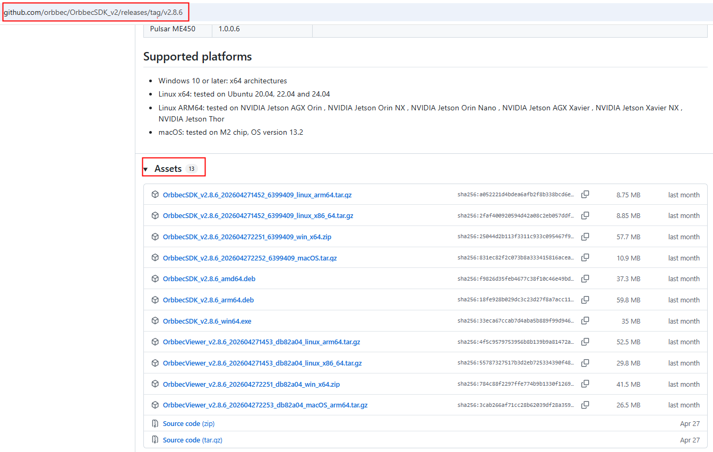
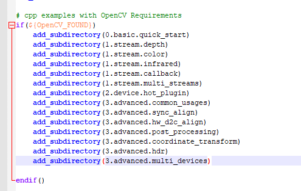

# 环境配置

## SDK 下载

请访问 Orbbec 官方 GitHub 仓库 [OrbbecSDK_v2 发布页面](https://github.com/orbbec/OrbbecSDK_v2/releases) 下载 SDK 的预编译版本。您也可以下载 [源代码](https://github.com/orbbec/OrbbecSDK_v2) 并自行编译。有关编译说明，请参阅 [如何构建 Orbbec SDK](https://github.com/orbbec/OrbbecSDK_v2/blob/main/docs/tutorial/building_orbbec_sdk.md)。

下图以 v2.8.6 版本为例。请访问 [OrbbecSDK_v2 发布页面](https://github.com/orbbec/OrbbecSDK_v2/releases/tag/v2.8.6)，在 “Assets” 栏目中下载预编译的 SDK 及 OrbbecViewer 工具。

## 设备支持验证

在使用 SDK 之前，请务必查看支持的设备列表，以确认您的设备是否兼容，并确保其能正常运行。

本页概述了所有支持的 [平台](https://github.com/orbbec/OrbbecSDK_v2?tab=readme-ov-file#13-supported-platforms) 和 [设备](https://github.com/orbbec/OrbbecSDK_v2?tab=readme-ov-file#14-supported-devices)。

## 开发环境配置

以 Windows 为例来配置开发环境。建议使用 Visual Studio 2019 作为集成开发环境（IDE）。请确保已正确安装 CMake、Visual Studio 2017 或更高版本、GCC、OpenCV 以及其他必要的依赖项。

为确保 SDK 示例能正确渲染和显示，请务必安装 OpenCV。否则示例可能无法运行或显示异常。

您可以通过此链接下载 OpenCV:[https://opencv.org/releases/](https://opencv.org/releases/)。

