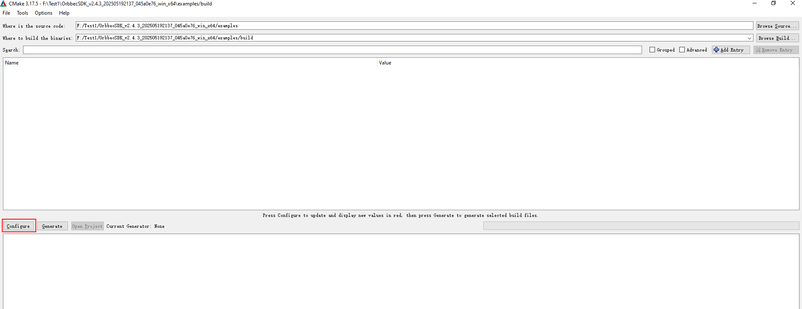
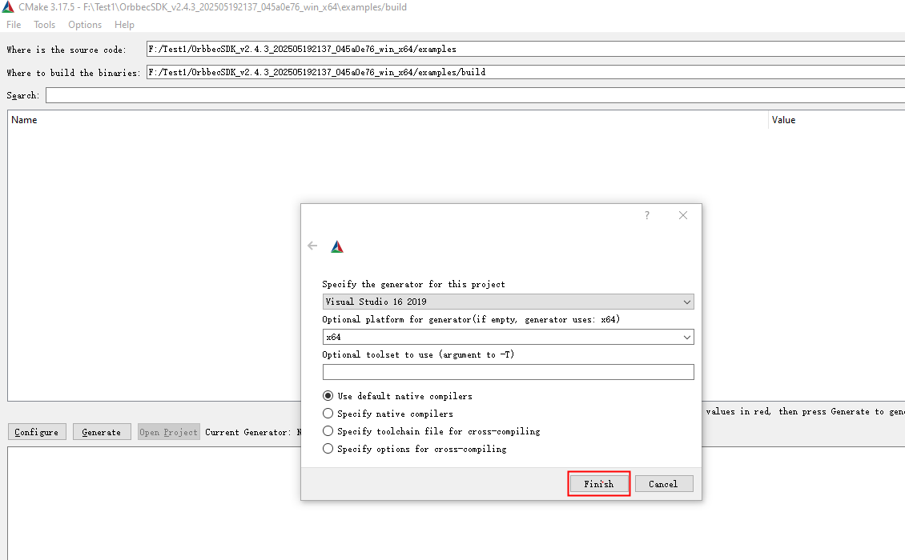
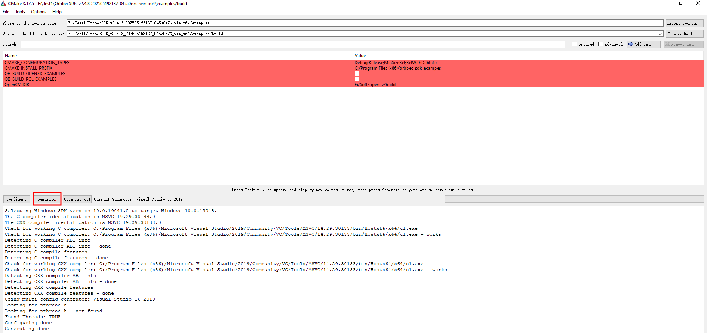
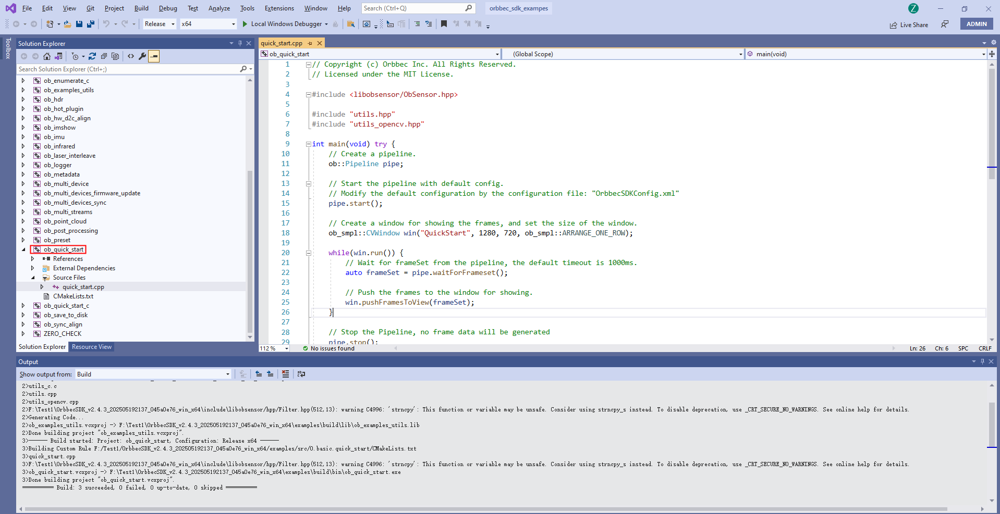
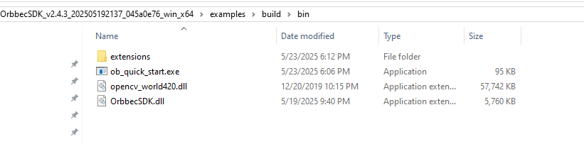
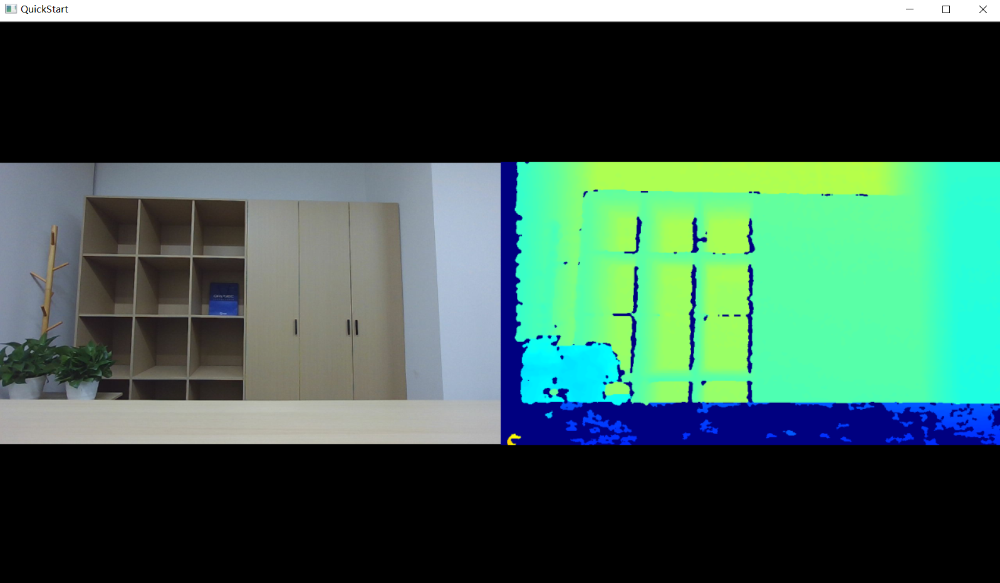
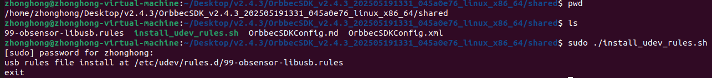
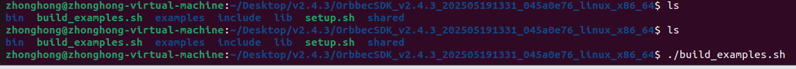
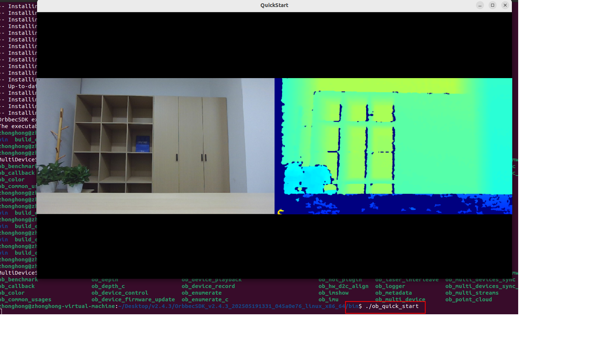

# Windows 系统的快速入门
## 元数据注册
在 Windows 平台上，您需要注册与帧相关的元数据（包括时间戳以及视频帧的其他信息等）。

元数据注册请参考：[/scripts/env_setup/obsensor_metadata_win10.md](https://github.com/orbbec/OrbbecSDK_v2/blob/main/scripts/env_setup/obsensor_metadata_win10.md)

**注意：如果未注册元数据，硬件时间戳将出现异常，从而影响 SDK 的内部帧同步功能。**

## 编译 SDK 包(.zip)
本节演示了如何在 Windows 平台上编译 SDK 包，帮助您快速上手。此处使用的 SDK 版本为[v2.4.3](https://github.com/orbbec/OrbbecSDK_v2/releases/tag/v2.4.3)。

- 首先，解压下载的 Orbbec SDK 包，然后进入解压目录中的 examples 文件夹，使用 CMake 编译工程。

- 点击 “Configure” 按钮，将出现如下对话框：

- 点击 “Finish” 按钮，将 OpenCV_DIR 设置为 OpenCV 的安装目录，然后点击 “Generate” 按钮，如下图所示：

- 使用 Visual Studio 2019 打开示例项目（orbbec_sdk_examples.sln）。

请将 ob_quick_start 示例作为入门示例，以了解并使用 SDK API。首先，编译 ob_quick_start 示例并运行它，以开始捕获数据流。

- 注意：
 请务必将所需的 SDK 动态库（扩展库和 OrbbecSDK.dll）以及 OpenCV DLL 文件复制到 ob_quick_start.exe 所在的目录中。OpenCV 库对于渲染示例视图至关重要。

ob_quick_start 示例可捕获并显示数据流，如下图所示：

# Linux 系统的快速入门

## 安装 udev 规则脚本
请使用以下命令进行安装：[/scripts/env_setup/install_udev_rules.sh](https://github.com/orbbec/OrbbecSDK_v2/blob/main/scripts/env_setup/install_udev_rules.sh)

~~~
cd OrbbecSDK_v2/scripts/env_setup
sudo chmod +x ./install_udev_rules.sh
sudo ./install_udev_rules.sh
sudo udevadm control --reload-rules && udevadm trigger
~~~

**注意：如果未执行此脚本，权限问题将导致无法打开设备。您需要使用 sudo（管理员权限）运行此示例。**

## 编译 SDK 包(.zip)

*   构建环境要求：

    * 操作系统：Ubuntu 18.04 或更高版本

    * 编译器：GCC，>=7.5

    * CMake：v3.15 或更高版本

    * OpenCV：推荐使用 3.4.0 版本

    * Visual Studio Code：推荐用于构建和调试的集成开发环境（IDE）

- 首先，下载 Orbbec SDK 软件包的 Linux 版本并解压。
然后进入共享目录并安装 udev 脚本，该脚本可确保加载正确的 libusb 驱动程序。
安装 udev 脚本后，您无需 sudo 权限即可运行示例程序。

安装过程如下图所示：

- 运行 build_examples.sh 脚本以编译示例。

- 进入 bin 目录，并运行 ob_quick_start 示例程序以捕获数据流。

# 如何使用安装包
如果您不想编译 Orbbec SDK，可以使用 SDK 安装包。以 [v2.4.8](https://github.com/orbbec/OrbbecSDK_v2/releases/tag/v2.4.8) 为例，首先下载适用于您平台的安装包。

- 文件 OrbbecSDK_vx.x.x_win64.exe 是 Orbbec SDK 和 Orbbec Viewer 工具在 Windows 系统上的安装包。
- 文件 OrbbecSDK_vx.x.x_amd64.deb 是 Orbbec SDK 和 Orbbec Viewer 工具在 Linux x86_64 系统（如 Ubuntu）上的安装包。
- 文件 OrbbecSDK_vx.x.x_arm64.deb 是 Orbbec SDK 和 Orbbec Viewer 工具在 ARM64 平台（如 NVIDIA Jetson AGX Orin、NVIDIA Jetson Orin NX、NVIDIA Jetson Orin Nano、NVIDIA Jetson AGX Xavier、NVIDIA Jetson Xavier NX）上的安装包。

## 使用 .deb 包安装
- 在 Linux x64（Ubuntu）平台上，可使用以下命令安装。（如果使用 ARM64 平台，请使用 OrbbecSDK_vx.x.x_arm64.deb。）
~~~
sudo dpkg -i OrbbecSDK_v2.x.x_amd64.deb
~~~
- 使用 dpkg -L orbbecsdk 可查看 Orbbec SDK 安装包内所有文件的安装路径；Orbbec SDK 的头文件和库文件将安装在 /usr/local 路径下。
~~~
dpkg -L orbbecsdk
~~~
- 运行 Orbbec Viewer。
~~~
sudo ./OrbbecViewer
~~~

## 使用 .exe 包安装
- 在 Windows 平台上，直接双击 OrbbecSDK_vx.x.x_win64.exe 即可安装。安装完成后，可在安装目录中运行 Orbbec Viewer 或使用 Orbbec SDK。