# 创建设备

获取设备有多种方法。
如果您需要同时使用多个设备，建议采用方法一、方法二或方法三。
如果您仅处理单个设备，建议使用方法四来访问该设备。

```c++
// 创建 Context
ob::Context ctx;

// 方法一
// 通过 Context 枚举所有已连接的设备。
std::shared_ptr<DeviceList> devices = ctx.queryDeviceList();
// 获取索引为 0 的设备。
auto device  = devices->getDevice(0);

// 方法二
// 通过 Context 枚举所有已连接的设备。
std::shared_ptr<DeviceList> devices = ctx.queryDeviceList();
// 通过序列号获取设备。
auto device = devices->getDeviceBySN("AE4M73D0040");

// 方法三
// 通过 Context 枚举所有已连接的设备。
std::shared_ptr<DeviceList> devices = ctx.queryDeviceList();
// 通过 UID 获取设备。
auto device = devices->getDeviceByUid("NDSG3958LKHY45");

// 方法四
ob::Pipeline pipe;
// 通过 Pipeline 获取设备。
auto         device = pipe.getDevice();
```

# 创建 Pipeline

创建 Pipeline 有两种方法。
如果您需要同时使用多个设备，请使用方法二，为每台设备创建独立的 Pipeline。
对于单设备场景，方法一是创建 Pipeline 最直接的方式。

```c++
// 方法一
ob::Pipeline pipe;

// 方法二，基于设备创建
auto pipe = std::make_shared<ob::Pipeline>(device);
```

# 获取传感器列表

先从设备获取传感器列表，然后从中查询所支持的传感器类型。

```c++
// 1.使用默认设备创建 Pipeline。
ob::Pipeline pipe;

// 2.通过 Pipeline 获取设备。
std::shared_ptr<ob::Device> device = pipe.getDevice();

// 3.通过设备获取传感器列表。
std::shared_ptr<ob::SensorList> sensorList = device->getSensorList();

// 4.为 Pipeline 创建 config。
std::shared_ptr<ob::Config> config = std::make_shared<ob::Config>();

// 5.查询所有支持的传感器类型。
for(uint32_t index = 0; index < sensorList->getCount(); index++) {
    OBSensorType sensorType = sensorList->getSensorType(index);
    std::cout << "Supported Sensor type: \n" << sensorType;
}
```

# 获取视频数据流

常见的数据流包括深度流、左红外、右红外以及彩色流。
以深度流为例，其分辨率设置为 640×400，帧率为 15 fps，输出格式为 Y16。
IR和彩色数据流的处理流程与此类似。

阻塞轮询模式与异步回调模式的区别：在阻塞轮询模式下，Pipeline 完成帧汇聚后会将帧插入队列，应用程序调用 waitForFrameset 从队列中获取帧数据。在异步回调模式下，帧汇聚完成后，帧会通过回调直接传递回应用程序。异步回调模式的优势在于实时性更强，但在回调函数中，应用层应避免执行耗时任务，并尽快释放该帧。

## 阻塞轮询模式

工作流程如下图：

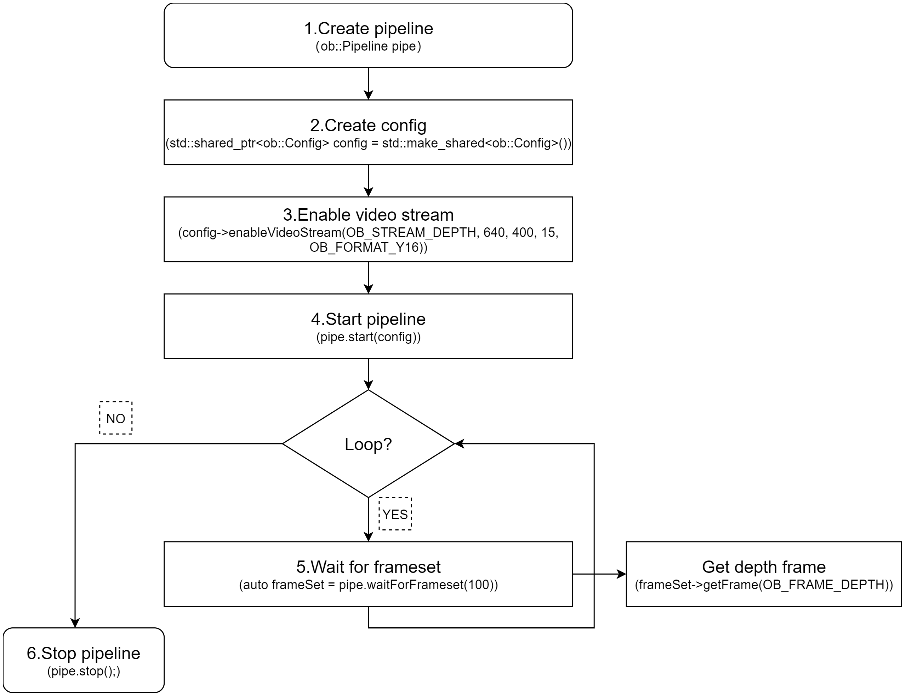

关键 API 描述：

```c++
// 1.使用默认设备创建 Pipeline。
ob::Pipeline pipe;

// 2.创建 config。
std::shared_ptr<ob::Config> config = std::make_shared<ob::Config>();

// 3.启用视频数据流。您可以根据使用需求修改相关参数。
config->enableVideoStream(OB_STREAM_DEPTH, 640, 400, 15, OB_FORMAT_Y16);

// 4.使用 config 启动 Pipeline。
pipe.start(config);

while(true) {
    // 5.在阻塞模式下，等待帧集，最多等待 100ms。
    auto frameSet = pipe.waitForFrameset(100);
    if(frameSet == nullptr) {
        continue;
    }
  
    // 获取深度帧。
    auto depthFrameRaw = frameSet->getFrame(OB_FRAME_DEPTH);
    if(depthFrameRaw) {
      // 通过 depthFrame 获取深度帧，处理深度数据。
      auto depthFrame = depthFrameRaw->as<ob::DepthFrame>();
      uint32_t        width  = depthFrame->getWidth();
      uint32_t        height = depthFrame->getHeight();
      const uint16_t *data   = reinterpret_cast<const uint16_t *>(depthFrame->getData());
    }
}

// 6.停止 Pipeline。
pipe.stop();
```

## 异步回调模式

工作流程如下图：

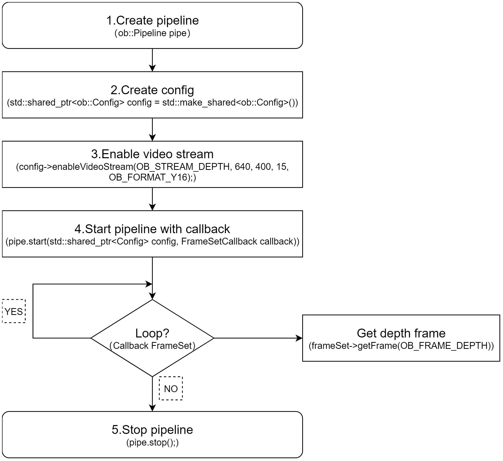

关键 API 描述：

```c++
// 1.使用默认设备创建 Pipeline。
ob::Pipeline pipe;

// 2.创建 config。
std::shared_ptr<ob::Config> config = std::make_shared<ob::Config>();


// 3.启用视频数据流。您可以根据使用需求修改相关参数。
config->enableVideoStream(OB_STREAM_DEPTH, 640, 400, 15, OB_FORMAT_Y16);

// 4.使用 config 和回调函数启动 Pipeline。
pipe.start(config, [&](std::shared_ptr<ob::FrameSet> frameSet) {
    // 获取深度帧。
    auto depthFrameRaw = frameSet->getFrame(OB_FRAME_DEPTH);
    if(depthFrameRaw) {
      // 通过 depthFrame 获取深度帧，处理深度数据。
      auto depthFrame = depthFrameRaw->as<ob::DepthFrame>();
      uint32_t        width  = depthFrame->getWidth();
      uint32_t        height = depthFrame->getHeight();
      const uint16_t *data   = reinterpret_cast<const uint16_t *>(depthFrame->getData());
    }
});

// 5.停止 Pipeline。
pipe.stop();
```

# 获取 IMU 数据流

## 阻塞轮询模式

工作流程如下图：

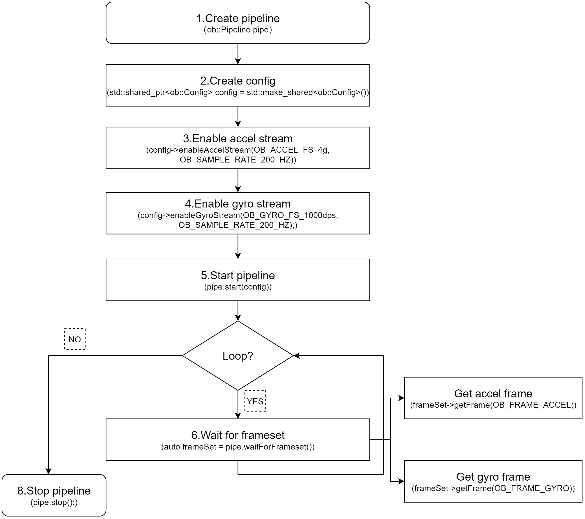

关键 API 描述：

```c++
// 1.使用默认设备创建 Pipeline。
ob::Pipeline pipe;

// 2.创建 config。
std::shared_ptr<ob::Config> config = std::make_shared<ob::Config>();

// 3.启用加速度计数据流。您可以根据使用需求修改相关参数。
config->enableAccelStream(OB_ACCEL_FS_4g, OB_SAMPLE_RATE_200_HZ);

// 4.启用陀螺仪数据流。您可以根据使用需求修改相关参数。
config->enableGyroStream(OB_GYRO_FS_1000dps, OB_SAMPLE_RATE_200_HZ);

// 5.使用 config 启动 Pipeline。
pipe.start(config);

while(true) {
    // 6.在阻塞模式下，等待帧集，最多等待 100ms。
    auto frameSet = pipe.waitForFrameset();
    if(frameSet == nullptr) {
        continue;
    }
    auto accelFrameRaw    = frameSet->getFrame(OB_FRAME_ACCEL);
    auto gyroFrameRaw    = frameSet->getFrame(OB_FRAME_GYRO);
}

// 7.停止 Pipeline。
pipe.stop();
```

## 异步回调模式

工作流程如下图：

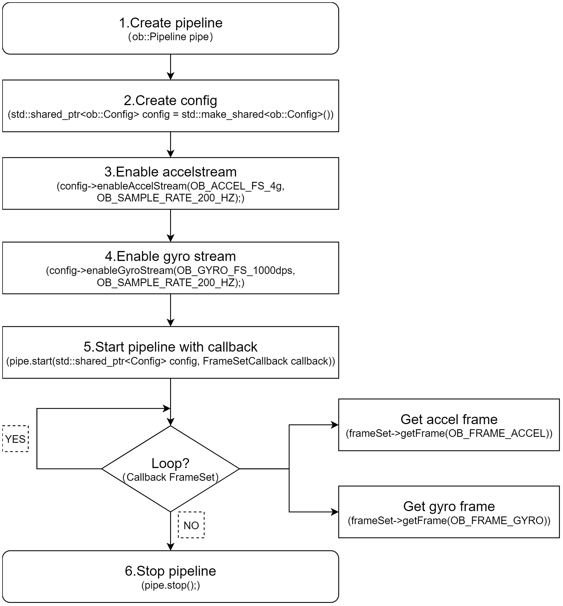

关键 API 描述：

```c++
// 1.使用默认设备创建 Pipeline。
ob::Pipeline pipe;

// 2.创建 config。
std::shared_ptr<ob::Config> config = std::make_shared<ob::Config>();

// 3.启用加速度计数据流。您可以根据使用需求修改相关参数。
config->enableAccelStream(OB_ACCEL_FS_4g, OB_SAMPLE_RATE_200_HZ);

// 4.启用陀螺仪数据流。您可以根据使用需求修改相关参数。
config->enableGyroStream(OB_GYRO_FS_1000dps, OB_SAMPLE_RATE_200_HZ);

// 5.使用 config 和回调函数启动 Pipeline。
pipe.start(config, [&](std::shared_ptr<ob::FrameSet> frameSet) {
    if(frameSet != nullptr) {
        auto accelFrameRaw    = frameSet->getFrame(OB_FRAME_ACCEL);
        auto gyroFrameRaw    = frameSet->getFrame(OB_FRAME_GYRO);
    }
});

// 6.停止 Pipeline。
pipe.stop();
```

# 帧汇聚

帧汇聚功能用于配置帧数据流的输出模式。该功能可通过 ob::Config 提供的接口设置。
帧汇聚共有四种模式。

关键 API 描述：

```c++
// 通过 ob::Config 提供的接口设置。
void setFrameAggregateOutputMode(OBFrameAggregateOutputMode mode);

// 帧汇聚包含的模式如下：
typedef enum {
    /**
     * @brief 仅输出包含所有类型数据帧的 FrameSet。
     */
    OB_FRAME_AGGREGATE_OUTPUT_ALL_TYPE_FRAME_REQUIRE = 0,
    /**
     * @brief 要求输出彩色帧的模式。
     * @brief 适用于彩色流使用 H264、H265 等帧间编码格式的场景。
     * @attention 在该模式下，从 FrameSet 中获取非彩色类型数据帧时，可能返回 null。
     */
    OB_FRAME_AGGREGATE_OUTPUT_COLOR_FRAME_REQUIRE,
    /**
     * @brief 任何情况下均输出 FrameSet。
     * @attention 在该模式下，从 FrameSet 中获取指定类型数据帧时，可能返回 null。
     */
    OB_FRAME_AGGREGATE_OUTPUT_ANY_SITUATION,
    /**
     * @brief 禁用帧汇聚
     * @attention 在该模式下，所有类型的数据帧将独立输出。
     */
    OB_FRAME_AGGREGATE_OUTPUT_DISABLE,
} OB_FRAME_AGGREGATE_OUTPUT_MODE,OBFrameAggregateOutputMode,ob_frame_aggregate_output_mode
```


例如，深度流、彩色流、左红外和右红外均已开启，且帧汇聚的模式设为 OB_FRAME_AGGREGATE_OUTPUT_ALL_TYPE_FRAME_REQUIRE时，返回的 FrameSet 将包含这四路流的非空帧数据。
示例代码如下所示：

```c++
// 1.使用默认设备创建 Pipeline。
ob::Pipeline pipe;
// 2.创建 config。
std::shared_ptr<ob::Config> config = std::make_shared<ob::Config>();
// 3.启用深度视频流。您可以根据使用需求修改相关参数。
config->enableVideoStream(OB_STREAM_DEPTH, 640, 480, 15, OB_FORMAT_Y16);
// 4.启用彩色视频流。您可以根据使用需求修改相关参数。
config->enableVideoStream(OB_STREAM_COLOR, 640, 480, 15, OB_FORMAT_YUYV);
// 5.启用左红外视频流。您可以根据使用需求修改相关参数。
config->enableVideoStream(OB_STREAM_IR_LEFT, 640, 480, 15, OB_FORMAT_Y8);
// 6.启用右红外视频流。您可以根据使用需求修改相关参数。
config->enableVideoStream(OB_STREAM_IR_RIGHT, 640, 480, 15, OB_FORMAT_Y8);
// 7.设置帧汇聚的输出模式，确保输出的帧集中包含所有类型的帧。
config->setFrameAggregateOutputMode(OB_FRAME_AGGREGATE_OUTPUT_ALL_TYPE_FRAME_REQUIRE);

// 8.使用 config 启动 Pipeline。
pipe.start(config);

while(true) {
    // 9.在阻塞模式下，等待帧集，最多等待 100ms。
    auto frameSet = pipe.waitForFrameset(100);
    if(frameSet == nullptr) {
        continue;
    }
  
    // 10.获取帧集中的各路帧。
    auto alignFrameSet = frame->as<ob::FrameSet>();
    if(frameSet != nullptr) {
       // 获取所有帧。
       auto depthFrameRaw = frameSet->getFrame(OB_FRAME_DEPTH);
       auto colorFrameRaw = frameSet->getFrame(OB_FRAME_COLOR);
       auto leftIrFrameRaw = frameSet->getFrame(OB_FRAME_IR_LEFT);
       auto RightIrFrameRaw = frameSet->getFrame(OB_FRAME_RIGHT_LEFT);
    }
}

// 11.停止 Pipeline。
pipe.stop();
```

工作流程如下图：

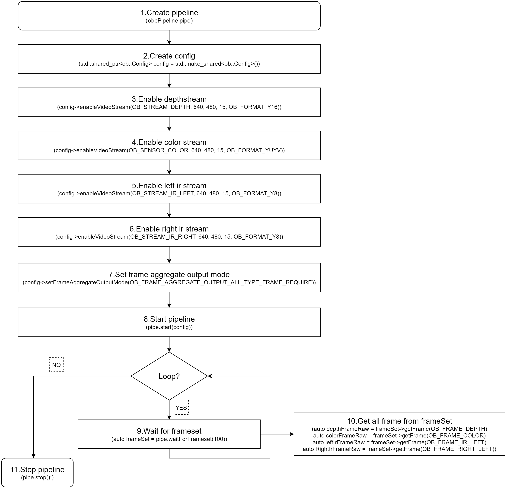

# D2C

D2C 要求同时启用深度流和彩色流，本节介绍硬件 D2C 和软件 D2C。

## 硬件 D2C


硬件 D2C 的关键接口是通过 ob::Config 将 D2C 模式设置为硬件模式，以启用硬件 D2C 功能。

```
config->setAlignMode(ALIGN_D2C_HW_MODE)
```

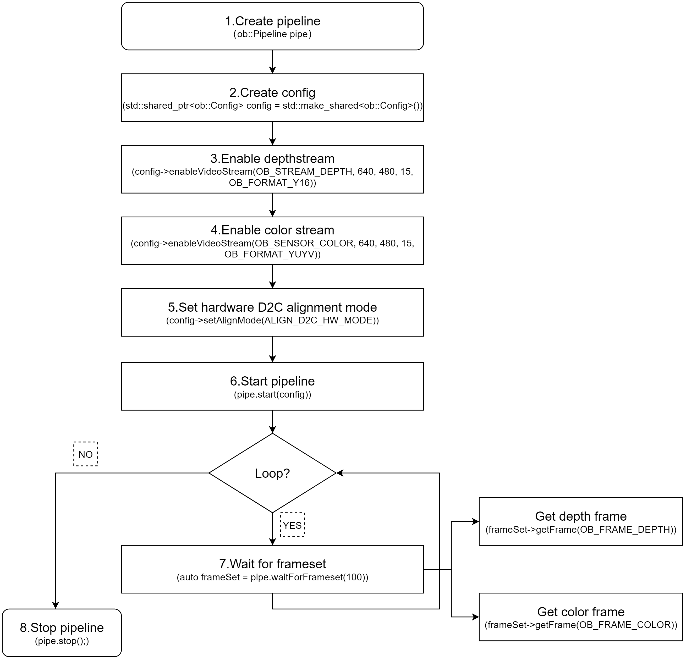

关键 API 描述：

```c++
// 1.使用默认设备创建 Pipeline。
ob::Pipeline pipe;

// 2.创建 config。
std::shared_ptr<ob::Config> config = std::make_shared<ob::Config>();

// 3.启用深度视频流。您可以根据使用需求修改相关参数。
config->enableVideoStream(OB_STREAM_DEPTH, 640, 480, 15, OB_FORMAT_Y16);

// 4.启用彩色视频流。您可以根据使用需求修改相关参数。
config->enableVideoStream(OB_STREAM_COLOR, 640, 480, 15, OB_FORMAT_YUYV);

// 5.设置硬件 D2C 对齐模式。
config->setAlignMode(ALIGN_D2C_HW_MODE);

// 6.使用 config 启动 Pipeline。
pipe.start(config);

while(true) {
    // 7.在阻塞模式下，等待帧集，最多等待 100ms。
    auto frameSet = pipe.waitForFrameset(100);
    if(frameSet == nullptr) {
        continue;
    }
  
    // 获取深度帧和彩色帧。
    auto depthFrameRaw = frameSet->getFrame(OB_FRAME_DEPTH);
    auto colorFrameRaw = frameSet->getFrame(OB_FRAME_COLOR);
}

// 8.停止 Pipeline。
pipe.stop();
```

## 软件 D2C


软件 D2C 可采用同步或异步两种方式，下文介绍异步方式。它通过 ob::Align 滤波器实现：获取帧集后，通过 pushFrame 方法将其推入 ob::Align，处理后的 D2C 帧集再通过回调异步返回。

- 核心接口
```
auto depth2colorAlign = std::make_shared <ob::Align>(OB_STREAM_COLOR);
```

工作流程如下图：

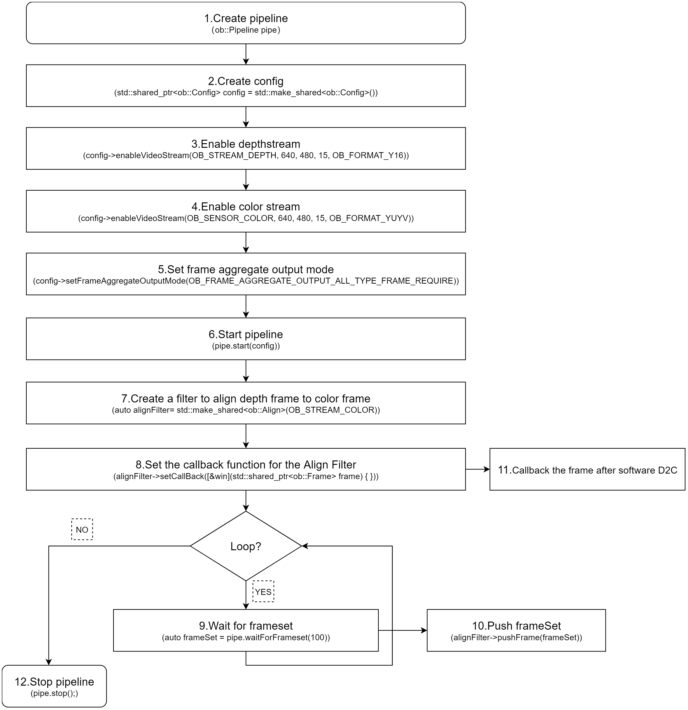

关键 API 描述：

```c++
// 1.使用默认设备创建 Pipeline。
ob::Pipeline pipe;

// 2.创建 config。
std::shared_ptr<ob::Config> config = std::make_shared<ob::Config>();

// 3.启用深度视频流。您可以根据使用需求修改相关参数。
config->enableVideoStream(OB_STREAM_DEPTH, 640, 480, 15, OB_FORMAT_Y16);

// 4.启用彩色视频流。您可以根据使用需求修改相关参数。
config->enableVideoStream(OB_STREAM_COLOR, 640, 480, 15, OB_FORMAT_YUYV);

// 5.设置帧汇聚的输出模式，确保输出的帧集中包含所有类型的帧。
config->setFrameAggregateOutputMode(OB_FRAME_AGGREGATE_OUTPUT_ALL_TYPE_FRAME_REQUIRE);

// 6.使用 config 启动 Pipeline。
pipe.start(config);

// 7.创建滤波器，将深度帧对齐到彩色帧。
auto depth2colorAlign = std::make_shared<ob::Align>(OB_STREAM_COLOR);

// 8.设置对齐滤波器的回调函数。
depth2colorAlign->setCallBack([&win](std::shared_ptr<ob::Frame> frame) {
    // 11.对齐之后输出的帧。
    auto alignFrameSet = frame->as<ob::FrameSet>();
    if(alignFrameSet != nullptr) {
       // 获取深度帧和彩色帧。
       auto depthFrameRaw = alignFrameSet->getFrame(OB_FRAME_DEPTH);
       auto colorFrameRaw = alignFrameSet->getFrame(OB_FRAME_COLOR);
    }
});

while(true) {
    // 9.在阻塞模式下，等待帧集，最多等待 100ms。
    auto frameSet = pipe.waitForFrameset(100);
    if(frameSet == nullptr) {
        continue;
    }
  
    // 10.将帧集推送到对齐滤波器，以对齐各帧。
    // 帧集将在内部线程中处理，得到的帧将通过回调函数异步输出。
    depth2colorAlign->pushFrame(frameSet);
}

// 12.停止 Pipeline。
pipe.stop();
```

# 软件 C2D

软件 C2D 可采用同步或异步两种方式，下文介绍异步方式。它通过 ob::Align 滤波器实现：获取帧集后，通过 pushFrame 方法将其推入 ob::Align，处理完成后由 ob::Align 的回调返回软件 C2D 生成的帧集。
**核心接口**
```
auto color2depthAlign = std::make_shared<ob::Align>(OB_STREAM_DEPTH);
```
工作流程如下图：

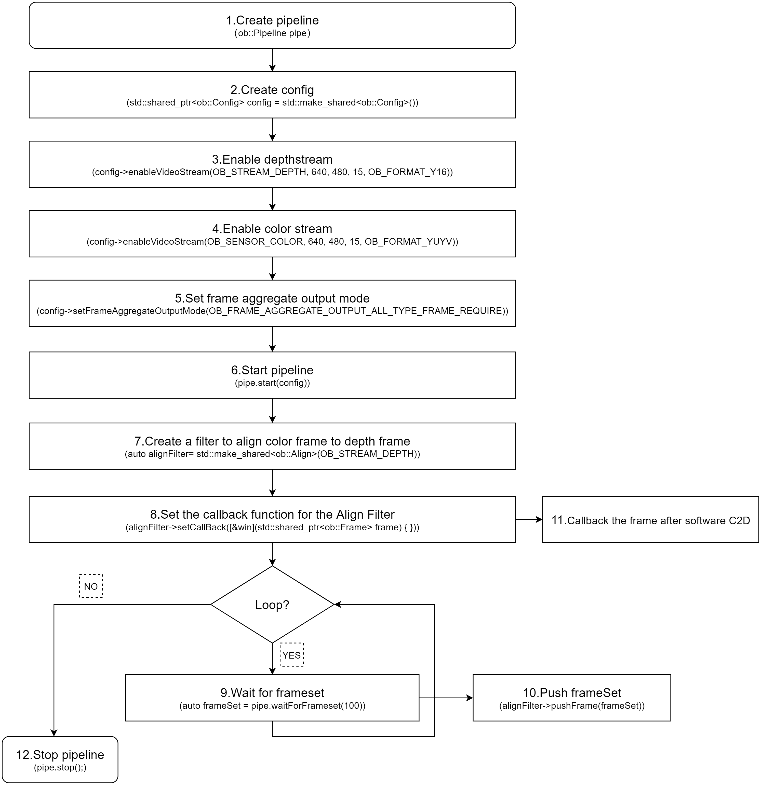

关键 API 描述：

```c++
// 1.使用默认设备创建 Pipeline。
ob::Pipeline pipe;

// 2.创建 config。
std::shared_ptr<ob::Config> config = std::make_shared<ob::Config>();

// 3.启用深度视频流。您可以根据使用需求修改相关参数。
config->enableVideoStream(OB_STREAM_DEPTH, 640, 480, 15, OB_FORMAT_Y16);

// 4.启用彩色视频流。您可以根据使用需求修改相关参数。
config->enableVideoStream(OB_STREAM_COLOR, 640, 480, 15, OB_FORMAT_RGB);

// 5.设置帧汇聚的输出模式，确保输出的帧集中包含所有类型的帧。
config->setFrameAggregateOutputMode(OB_FRAME_AGGREGATE_OUTPUT_ALL_TYPE_FRAME_REQUIRE);

// 6.使用 config 启动 Pipeline。
pipe.start(config);

// 7.创建滤波器，将彩色帧对齐到深度帧。
auto color2depthAlign = std::make_shared<ob::Align>(OB_STREAM_DEPTH);

// 8.设置对齐滤波器的回调函数。
depth2colorAlign->setCallBack([&win](std::shared_ptr<ob::Frame> frame) {
    // 11.对齐之后输出的帧。
    auto alignFrameSet = frame->as<ob::FrameSet>();
    if(frameSet != nullptr) {
       // 获取深度帧和彩色帧。
       auto depthFrameRaw = frameSet->getFrame(OB_FRAME_DEPTH);
       auto colorFrameRaw = frameSet->getFrame(OB_FRAME_COLOR);
    }
});

while(true) {
    // 9.在阻塞模式下，等待帧集，最多等待 100ms。
    auto frameSet = pipe.waitForFrameset(100);
    if(frameSet == nullptr) {
        continue;
    }
  
    // 10.将帧集推送到对齐滤波器，以对齐各帧。
    // 帧集将在内部线程中处理，得到的帧将通过回调函数异步输出。
    color2depthAlign->pushFrame(frameSet);
}

// 12.停止 Pipeline。
pipe.stop();
```

# 深度点云

该 SDK 提供了 ob::PointCloudFilter，用于处理深度数据并生成点云。深度数据既可以通过阻塞式方法获取，也可以通过回调获取。用户可以根据具体需求选择合适的方法。下一节将演示如何使用阻塞式方法获取深度流，并使用 ob::PointCloudFilter 生成点云。

使用 ob::PointCloudFilter 将深度数据转换为点云有两种方式：同步模式和异步回调模式。

## 同步模式

ob::PointCloudFilter 接口在同步模式下的用法。

```c++
// 创建 PointCloudFilter。
auto pointCloud = std::make_shared<ob::PointCloudFilter>();

// 设置创建点云格式。
pointCloud->setCreatePointFormat(OB_FORMAT_POINT);

// 处理帧集以生成点云帧（也可以传入单个深度帧进行处理）。
std::shared_ptr<ob::Frame> frame = pointCloud->process(frameset);
```

工作流程如下图：

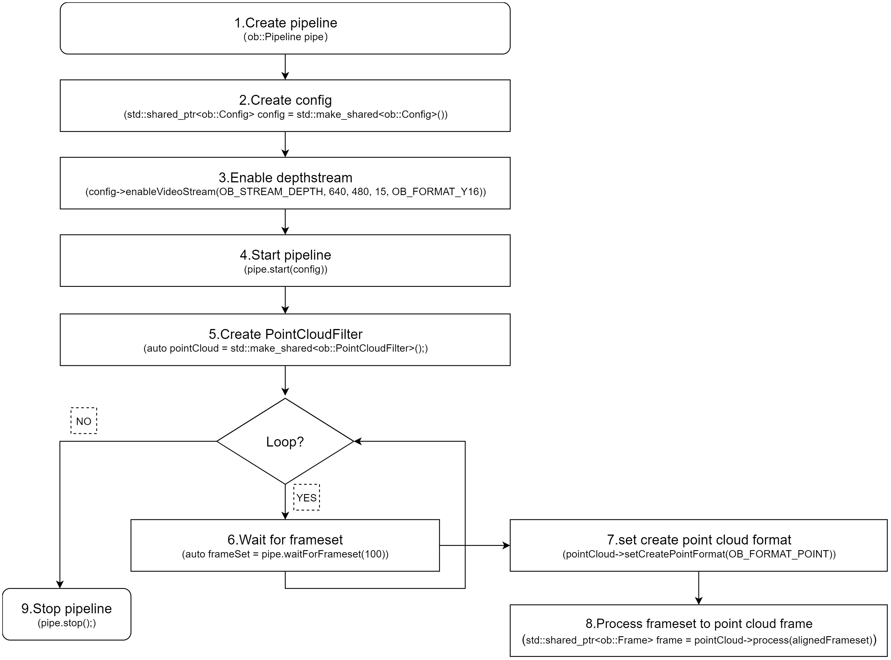

关键 API 描述：

```c++
// 1.使用默认设备创建 Pipeline。
ob::Pipeline pipe;
// 2.创建 config。
std::shared_ptr<ob::Config> config = std::make_shared<ob::Config>();
// 3.启用深度视频流。您可以根据使用需求修改相关参数。
config->enableVideoStream(OB_STREAM_DEPTH, 640, 480, 15, OB_FORMAT_Y16);
// 4.使用 config 启动 Pipeline。
pipe.start(config);

// 5.创建点云滤波器，用于根据深度帧和彩色帧生成点云帧。
auto pointCloud = std::make_shared<ob::PointCloudFilter>();

while(true) {
    // 6.在阻塞模式下，等待帧集，最多等待 100ms。
    auto frameSet = pipe.waitForFrameset(100);
    if(frameSet == nullptr) {
        continue;
    }
  
    // 7.设置创建点云格式。
    pointCloud->setCreatePointFormat(OB_FORMAT_POINT);

    // 8.处理帧集以生成点云帧（也可以传入单个深度帧进行处理）。
    std::shared_ptr<ob::Frame> frame = pointCloud->process(frameSet);
}

// 9.停止 Pipeline。
pipe.stop();
```

## 异步回调模式

ob::PointCloudFilter 接口的异步用法：

```c++
// 创建 PointCloudFilter。
auto pointCloud = std::make_shared<ob::PointCloudFilter>();

// 设置回调
pointCloud->setCallBack([&win](std::shared_ptr<ob::Frame> frame) { 
  // TODO:返回点云滤波后的帧。
});

// 设置创建点云格式。
pointCloud->setCreatePointFormat(OB_FORMAT_POINT);

// 将 waitForFrameset 返回的帧集传递给点云滤波器进行处理。
pointCloud->pushFrame(frameSet);
```

工作流程如下图：

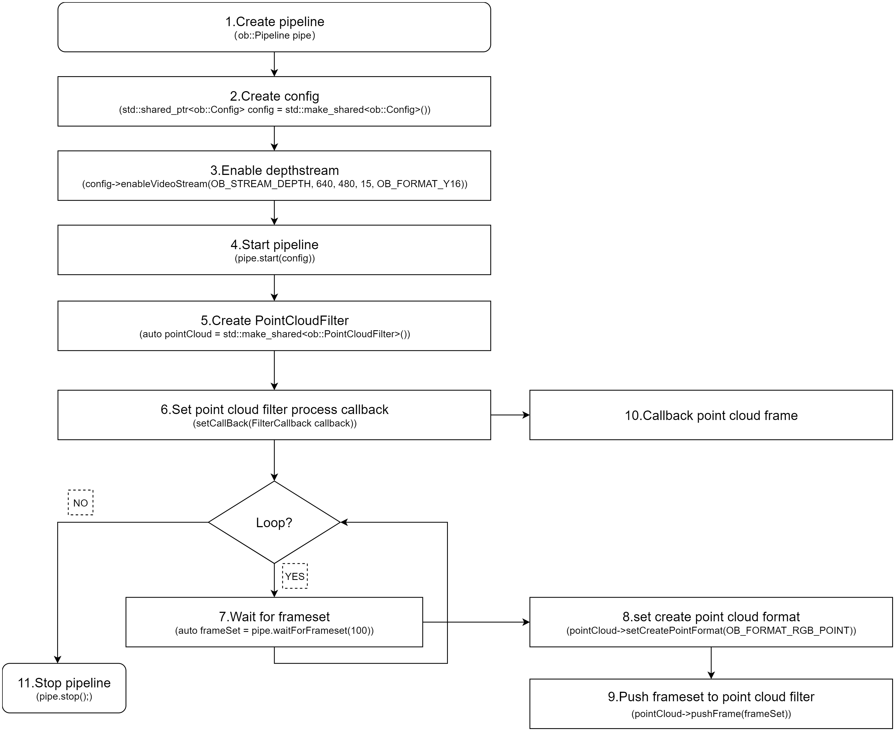

关键 API 描述：

```c++
// 1.使用默认设备创建 Pipeline。
ob::Pipeline pipe;
// 2.创建 config。
std::shared_ptr<ob::Config> config = std::make_shared<ob::Config>();
// 3.启用深度视频流。您可以根据使用需求修改相关参数。
config->enableVideoStream(OB_STREAM_DEPTH, 640, 480, 15, OB_FORMAT_Y16);
// 4.使用 config 启动 Pipeline。
pipe.start(config);

// 5.创建点云滤波器，用于根据深度帧和彩色帧生成点云帧。
auto pointCloud = std::make_shared<ob::PointCloudFilter>();

// 6.设置点云滤波器的回调函数。
pointCloud->setCallBack([&win](std::shared_ptr<ob::Frame> frame) {
    // 10.经过点云滤波处理后的帧。
    // TODO:用户处理。
});

while(true) {
    // 7.在阻塞模式下，等待帧集，最多等待 100ms。
    auto frameSet = pipe.waitForFrameset(100);
    if(frameSet == nullptr) {
        continue;
    }

    // 8.设置创建点云格式。
    pointCloud->setCreatePointFormat(OB_FORMAT_POINT);

    // 9.将帧集推送到点云滤波器，以生成点云。
    // 帧集将在内部线程中处理，得到的帧将通过回调函数异步输出。
    pointCloud->pushFrame(frameSet);
}

// 11.停止 Pipeline。
pipe.stop();
```

# RGBD 点云

通过 SDK 同时采集深度数据流和彩色数据流，经过 ob::PointCloudFilter 处理，最终生成 RGBD 点云。

深度流和彩色流既可以通过阻塞方式获取，也可以通过回调方式获取，用户可根据具体需求进行选择。
以下演示如何通过阻塞方式获取深度流和彩色流，并使用 ob::PointCloudFilter 生成 RGBD 点云。

使用 ob::PointCloudFilter 根据深度帧和彩色帧生成 RGBD 点云数据有两种方式：同步模式和异步回调模式。

## 同步模式

在同步模式下使用 ob::PointCloudFilter：

```c++
// 1.创建 PointCloudFilter。
auto pointCloud = std::make_shared<ob::PointCloudFilter>();

// 2.设置创建 RGBD 点云格式。
pointCloud->setCreatePointFormat(OB_FORMAT_RGB_POINT);

// 3.处理帧集以生成点云帧（也可以传入单个深度帧进行处理）。
std::shared_ptr<ob::Frame> frame = pointCloud->process(frameset);
```

工作流程如下图：

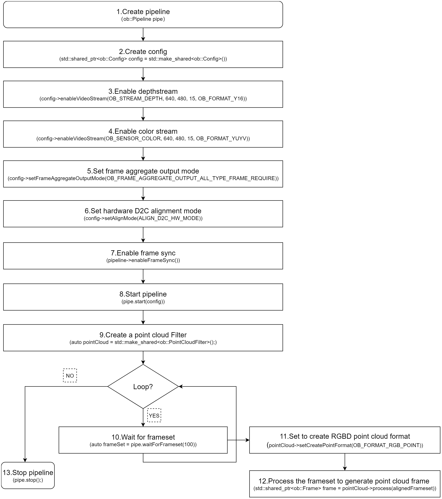

关键 API 描述：

```c++
// 1.使用默认设备创建 Pipeline。
ob::Pipeline pipe;
// 2.创建 config。
std::shared_ptr<ob::Config> config = std::make_shared<ob::Config>();
// 3.启用深度视频流。您可以根据使用需求修改相关参数。
config->enableVideoStream(OB_STREAM_DEPTH, 640, 480, 15, OB_FORMAT_Y16);
// 4.启用彩色视频流。您可以根据使用需求修改相关参数。
config->enableVideoStream(OB_STREAM_COLOR, 640, 480, 15, OB_FORMAT_YUYV);
// 5.设置帧汇聚的输出模式，确保输出的帧集中包含所有类型的帧。
config->setFrameAggregateOutputMode(OB_FRAME_AGGREGATE_OUTPUT_ALL_TYPE_FRAME_REQUIRE);
// 6.设置硬件 D2C 对齐模式。
config->setAlignMode(ALIGN_D2C_HW_MODE)

// 7.启用帧同步，确保帧集中深度帧和彩色帧保持同步。
pipe.enableFrameSync();
// 8.使用 config 启动 Pipeline。
pipe.start(config);

// 9.创建点云滤波器，用于根据深度帧和彩色帧生成点云帧
auto pointCloud = std::make_shared<ob::PointCloudFilter>();

while(true) {
    // 10.在阻塞模式下，等待帧集，最多等待 100ms。
    auto frameSet = pipe.waitForFrameset(100);
    if(frameSet == nullptr) {
        continue;
    }
  
    // 11.设置创建 RGBD 点云格式（仅当帧集中包含彩色帧和深度帧时生效）。
    pointCloud->setCreatePointFormat(OB_FORMAT_RGB_POINT);

    // 12.处理帧集以生成点云帧（也可以传入单个深度帧进行处理）。
    std::shared_ptr<ob::Frame> frame = pointCloud->process(frameSet);
}

// 13.停止 Pipeline。
pipe.stop();
```

## 异步回调模式

在异步回调模式下使用 ob::PointCloudFilter：

```c++
// 1.创建 PointCloudFilter。
auto pointCloud = std::make_shared<ob::PointCloudFilter>();

// 2.设置回调。
pointCloud->setCallBack([&win](std::shared_ptr<ob::Frame> frame) { 
  // TODO:返回点云滤波后的帧。
});

// 3.设置创建 RGBD 点云格式。
pointCloud->setCreatePointFormat(OB_FORMAT_RGB_POINT);

// 4.将 waitForFrameset 返回的帧集传递给点云滤波器进行处理。
pointCloud->pushFrame(frameSet);
```

工作流程如下图：

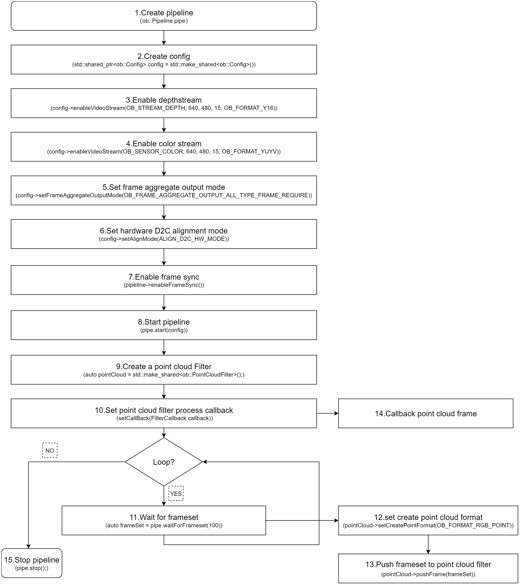

关键 API 描述：

```c++
// 1.使用默认设备创建 Pipeline。
ob::Pipeline pipe;
// 2.创建 config。
std::shared_ptr<ob::Config> config = std::make_shared<ob::Config>();
// 3.启用深度视频流。您可以根据使用需求修改相关参数。
config->enableVideoStream(OB_STREAM_DEPTH, 640, 480, 15, OB_FORMAT_Y16);
// 4.启用彩色视频流。您可以根据使用需求修改相关参数。
config->enableVideoStream(OB_STREAM_COLOR, 640, 480, 15, OB_FORMAT_YUYV);
// 5.设置帧汇聚的输出模式，确保输出的帧集中包含所有类型的帧。
config->setFrameAggregateOutputMode(OB_FRAME_AGGREGATE_OUTPUT_ALL_TYPE_FRAME_REQUIRE);
// 6.设置硬件 D2C 对齐模式。
config->setAlignMode(ALIGN_D2C_HW_MODE)

// 7.启用帧同步，确保帧集中深度帧和彩色帧保持同步。
pipe.enableFrameSync();
// 8.使用 config 启动 Pipeline。
pipe.start(config);

// 9.创建点云滤波器，用于根据深度帧和彩色帧生成点云帧。
auto pointCloud = std::make_shared<ob::PointCloudFilter>();

// 10.设置点云滤波器的回调函数。
pointCloud->setCallBack([&win](std::shared_ptr<ob::Frame> frame) {
    // 14.经过点云滤波处理后的帧。
    // TODO:用户处理。
});

while(true) {
    // 11.在阻塞模式下，等待帧集，最多等待 100ms。
    auto frameSet = pipe.waitForFrameset(100);
    if(frameSet == nullptr) {
        continue;
    }
  
    // 12.设置创建 RGBD 点云格式（仅当帧集中包含彩色帧和深度帧时生效）。
    pointCloud->setCreatePointFormat(OB_FORMAT_RGB_POINT);

    // 13.处理帧集以生成点云帧（也可以传入单个深度帧进行处理）。
    std::shared_ptr<ob::Frame> frame = pointCloud->process(frameSet);
}

// 15.停止 Pipeline。
pipe.stop();
```

# 去噪滤波

## 硬件去噪滤波

硬件去噪滤波通过设备处理减少深度噪声。
目前，此功能仅在 Gemini 330 系列设备上支持（固件版本 v1.4.60 及以上）。

启用硬件滤波时，建议禁用软件去噪滤波，以降低 CPU 占用率。

关键 API 描述：

```c++
auto device = pipe.getDevice();
if(device->isPropertySupported(OB_PROP_HW_NOISE_REMOVE_FILTER_ENABLE_BOOL, OB_PERMISSION_READ_WRITE)) {
    // 1.启用硬件去噪滤波。
    device->setBoolProperty(OB_PROP_HW_NOISE_REMOVE_FILTER_ENABLE_BOOL, true);
    // 2.调整硬件去噪滤波的阈值。
    device->setFloatProperty(OB_PROP_HW_NOISE_REMOVE_FILTER_THRESHOLD_FLOAT, 0.1);
}
```

工作流程如下图：

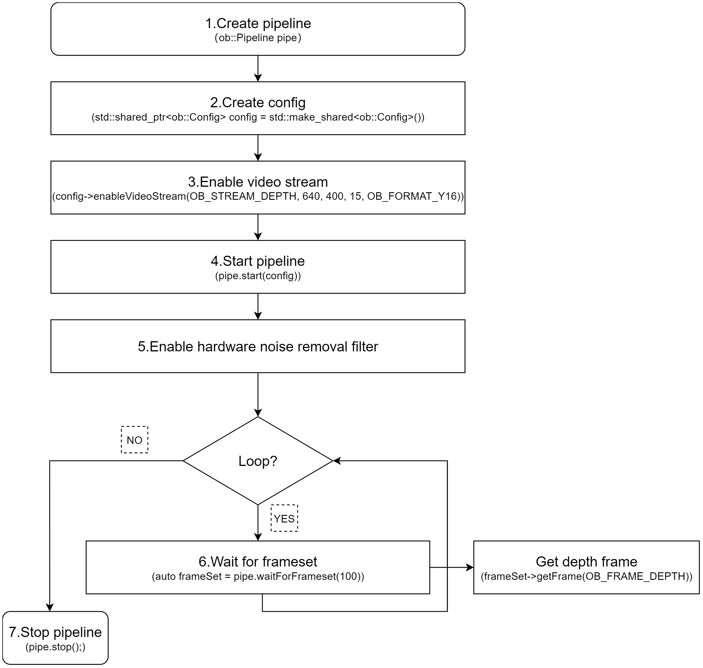

## 软件去噪滤波

软件去噪滤波是 SDK 提供的一项处理功能，可通过软件算法降低深度噪声。

关键 API 描述：

```c++
// 1.通过 Pipeline 获取设备
auto device = pipe.getDevice();
// 2.判断是否启用滤波器。
auto enable = device->getBoolProperty(OB_PROP_DEPTH_NOISE_REMOVAL_FILTER_BOOL);
// 3.获取滤波器的相关参数。
auto max_diff = device->getIntProperty(OB_PROP_DEPTH_NOISE_REMOVAL_FILTER_MAX_DIFF_INT);
auto max_size = device->getIntProperty(OB_PROP_DEPTH_NOISE_REMOVAL_FILTER_MAX_SPECKLE_SIZE_INT);
// 4.设置滤波器的相关参数。
device->setBoolProperty(OB_PROP_DEPTH_NOISE_REMOVAL_FILTER_BOOL,true);
device->setIntProperty(OB_PROP_DEPTH_NOISE_REMOVAL_FILTER_MAX_DIFF_INT, 512);
device->setIntProperty(OB_PROP_DEPTH_NOISE_REMOVAL_FILTER_MAX_SPECKLE_SIZE_INT, 960);
```

# Depth 后处理滤波

SDK 提供了一组推荐的后处理滤波器。有关后处理滤波器列表接口的使用方法，请参阅 SDK 自带的 advanced.post_processing 示例。

```c++
// 1.使用默认设备创建 Pipeline。
ob::Pipeline pipe;

// 2.获取设备和传感器，并获取该传感器推荐的滤波器列表。
auto device     = pipe.getDevice();
// 3.获取深度传感器。
auto sensor     = device->getSensor(OB_SENSOR_DEPTH);
// 4.创建推荐的滤波器列表。
auto filterList = sensor->createRecommendedFilters();

// 5.将推荐的滤波器应用于深度帧。
for(auto &filter: filterList) {
    if(filter->isEnabled()) {  //仅应用已启用的滤波器
        processedFrame = filter->process(depthFrame);
    }
}
```

工作流程如下图：

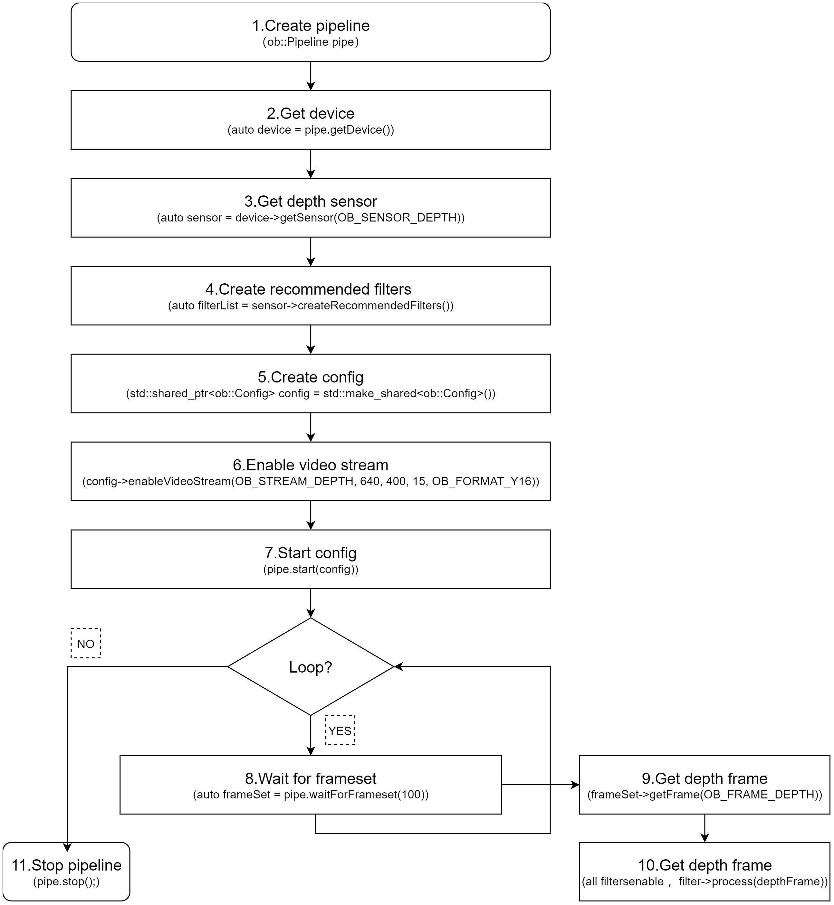

# 录制与回放


## 录制

录制数据流主要由 ob::RecordDevice 实现。

以深度流为例，分辨率设置为 640×400，帧率为 15 fps，输出格式为 Y16。
录制IR和彩色视频流的方法类似。
如果要同时录制多个流，可以将它们一并启用。

关键 API 描述：
```c++
// 使用输出文件初始化录制设备，并开始录制
auto recordDevice = std::make_shared<ob::RecordDevice>(device, filePath);

// 暂停
recorder->pause();

// 恢复
recorder->resume();
```

工作流程如下图：

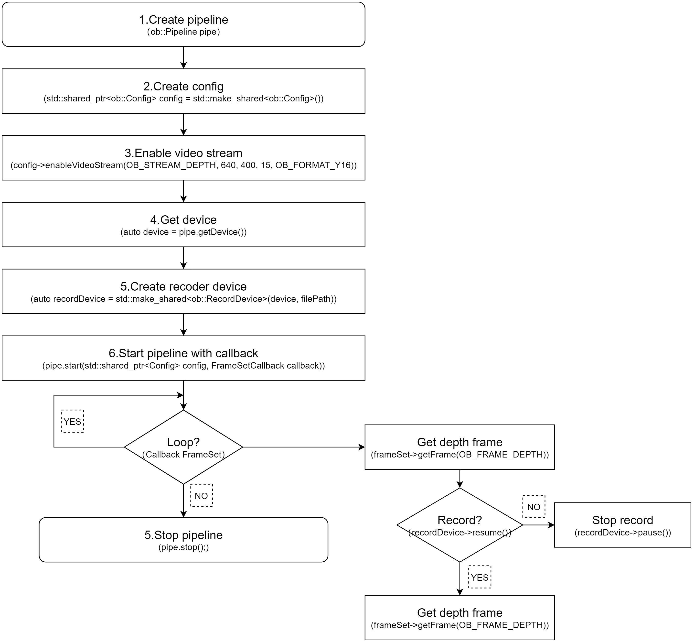

## 回放

回放数据流主要由 ob::PlaybackDevice 实现。
有关回放的详细实现，请参阅 SDK 自带的 ob_device_playback 示例。

关键 API 描述：

```c++
// 使用输入文件初始化回放设备。
std::shared_ptr<ob::PlaybackDevice> playback = std::make_shared<ob::PlaybackDevice>(filePath);

// 设置回放速度，设置为 2 表示以两倍速度回放。
playback->setPlaybackRate(2);  

// 回放设备的时长，单位为毫秒。
playback->getDuration(); 

// 获取当前回放位置。
playback->getPosition();

// 设置回放的起始点，该起始点必须位于录制内容的总时长之内。
playback->seek(timestamp) 
```

工作流程如下图：

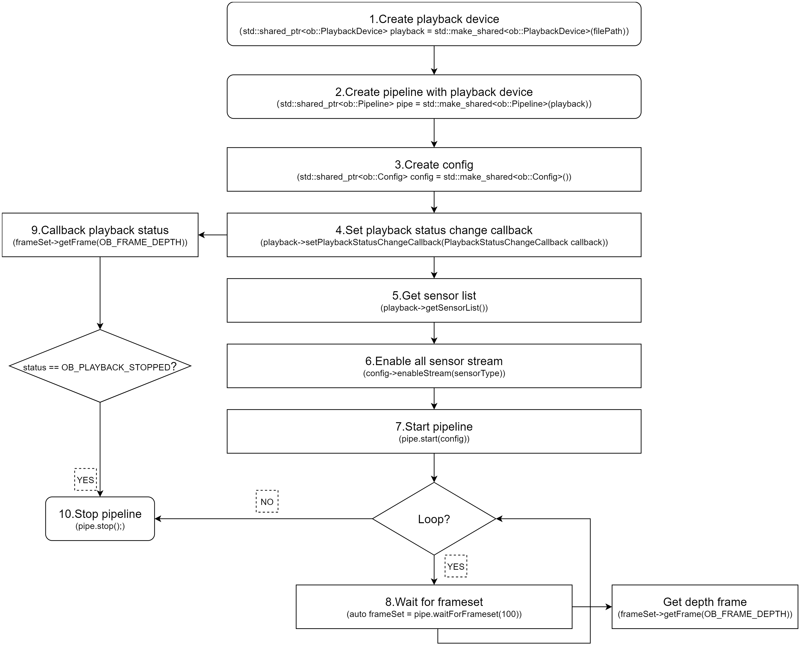

关键 API 描述：

```c++
// 获取有效的 .bag 文件。
std::string   filePath = "./Depth.bag";

// 1.使用 Rosbag 文件创建回放设备
std::shared_ptr<ob::PlaybackDevice> playback = std::make_shared<ob::PlaybackDevice>(filePath);
// 2.使用回放设备创建 Pipeline。
std::shared_ptr<ob::Pipeline> pipe = std::make_shared<ob::Pipeline>(playback);
// 3.启用播放设备上的所有录制流。
std::shared_ptr<ob::Config> config = std::make_shared<ob::Config>();

// 4.设置回放状态变化回调，当回放停止时，使用相同的 config 重新启动 Pipeline。
bool playbackStop = false;
playback->setPlaybackStatusChangeCallback([&](OBPlaybackStatus status) {
    if(status == OB_PLAYBACK_STOPPED) {
        playbackStop = true;
      }
});

// 5.获取回放传感器列表。
auto sensorList = playback->getSensorList();
// 6.启用回放数据流。
for(uint32_t i = 0; i < sensorList->getCount(); i++) {
    auto sensorType = sensorList->getSensorType(i);
    config->enableStream(sensorType);
}

// 7.使用 config 启动 Pipeline。
pipe->start(config);

while(!playbackStop) {
    auto frameSet = pipe->waitForFrames(1000);
    if(frameSet == nullptr) {
        continue;
    }
    // 获取深度帧
    auto depthFrame = frameSet->getFrame(OB_FRAME_DEPTH)
}

// 9.停止 Pipeline。
pipe->stop();
```

# 固件升级


用户可以根据需要为 RGBD 相机开发固件升级功能。
以下演示如何升级单个 RGBD 相机的固件，并给出相应的流程图。

工作流程如下图：

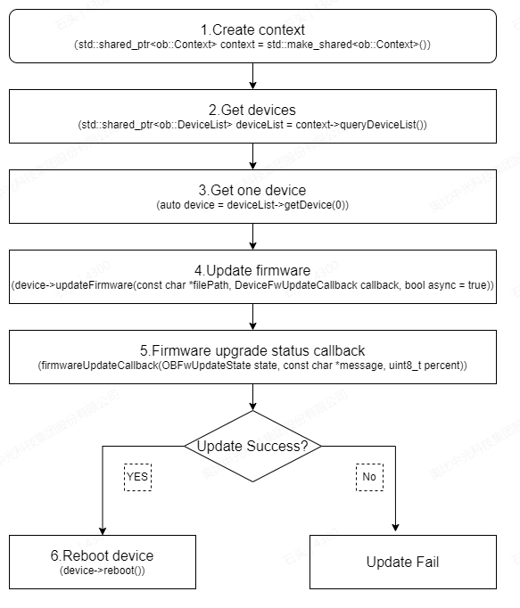

关键 API 描述：

```c++

// 1.创建 Context 以访问已连接的设备。
std::shared_ptr<ob::Context> context = std::make_shared<ob::Context>();
// 2.通过 Context 获取已连接的设备。
std::shared_ptr<ob::DeviceList> deviceList = context->queryDeviceList();
// 3.获取第一台设备。
auto device = deviceList->getDevice(0);
// 4.将 async 设置为 false，以同步阻塞方式等待设备固件升级完成。
devices->updateFirmware(firmwarePath, firmwareUpdateCallback, false);

// 5.固件升级状态回调。
void firmwareUpdateCallback(OBFwUpdateState state, const char *message, uint8_t percent) {
    switch(state) {
    case STAT_VERIFY_SUCCESS:
        std::cout << "Image file verification success" << std::endl;
        break;
    case STAT_FILE_TRANSFER:
        std::cout << "File transfer in progress" << std::endl;
        break;
    case STAT_DONE:
        std::cout << "Update completed" << std::endl;
        break;
    case STAT_IN_PROGRESS:
        std::cout << "Upgrade in progress" << std::endl;
        break;
    case STAT_START:
        std::cout << "Starting the upgrade" << std::endl;
        break;
    case STAT_VERIFY_IMAGE:
        std::cout << "Verifying image file" << std::endl;
        break;
    default:
        std::cout << "Unknown status or error" << std::endl;
        break;
    }
    std::cout << "Message : " << message << std::endl << std::flush;
}

// 6.升级成功后重启设备。
device->reboot();
```

更新多台设备的固件，请参阅：[multi device firmware update](https://github.com/orbbec/OrbbecSDK_v2/tree/main/examples/2.device.multi_devices_firmware_update)

# 深度预设

更新可选的深度预设，请参阅：[optional_depth_presets_update](https://github.com/orbbec/OrbbecSDK_v2/tree/main/examples/2.device.optional_depth_presets_update)


- 为固件升级进度定义一个回调函数。

您可以定义一个回调函数，以获取固件升级进度。每当设备更新其进度时，都会调用该回调函数。
```
    void presetUpdateCallback(OBFwUpdateState state, const char *message, uint8_t percent) {
        // 此处展示更新状态和信息。
    }
```

- 更新可选的深度预设。

选择设备后，通过调用 updateOptionalDepthPresets 函数并传入指定的回调，即可更新该设备的预设。
```
    device->updateOptionalDepthPresets(filePaths, count, presetUpdateCallback);
```

注意：该 API 支持一次升级多个预设。对于 G300 系列设备，一次最多可写入 3 个预设。第一个写入的预设将被设置为默认预设。


# 设备断开与重新连接

SDK 提供了一个设备连接状态变化监听器，它有助于用户在设备断开连接时处理异常，并在设备重新连接时进行恢复。

```c++
// 1.创建 Context。
ob::Context ctx;

// 2.注册设备回调。
ctx.setDeviceChangedCallback([](std::shared_ptr<ob::DeviceList> removedList, std::shared_ptr<ob::DeviceList> deviceList) {
        // 连接设备。
        printDeviceList("added", deviceList);
        // 断开设备连接。
        printDeviceList("removed", removedList);
    });
```

在 ob::Context 的 setDeviceChangedCallback 回调中，removedList 表示 SDK 检测到设备断开连接（离线），而 deviceList 表示 SDK 检测到设备建立连接（在线）。

# 常用接口

## 获取序列号

```c++
auto         device = pipe.getDevice();
auto deviceInfo = device->getDeviceInfo();
std::string serialNumber = deviceInfo->serialNumber();
```
## LDP 开关
LDP（激光距离保护）模块能够检测近距离的物体。启用 LDP 后，系统会检测相机指定距离范围内的障碍物，并逐渐降低激光功率等级，直至关闭激光，从而实现激光保护。禁用 LDP 时，该功能随之停用。
```c++
device->setBoolProperty(OB_PROP_LDP_BOOL, true);
```

## LRM 开关
LRM（激光测距模块）使用与 LDP 开关相同的控制接口。支持该功能的设备为 Gemini 330 系列、Gemini 435Le 和 Gemini 305/305g。请注意，以上设备不支持 LDP 功能。

```c++
device->setBoolProperty(OB_PROP_LDP_BOOL, true);
```

## 获取 LDP 测量值
用于在启用 LDP（激光距离保护）或 LRM（激光测距模块）时获取测量值。

```c++
int32_t value = device->getIntProperty(OB_PROP_LDP_MEASURE_DISTANCE_INT);
```

## 获取 LDP 保护状态

```c++
 bool status = device->getBoolProperty(OB_PROP_LDP_STATUS_BOOL);
```

## 激光开关模式

Gemini 330 开启或关闭激光的命令如下：

```c++
// Gemini 330 系列激光控制，0：关闭，1：开启，2：自动
device->setBoolProperty(OB_PROP_LASER_CONTROL_INT, 1);
```

对于非 Gemini 330 设备，开启或关闭激光的命令如下：

```c++
device->setBoolProperty(OB_PROP_LASER_BOOL, true);
```

## 设备重启

```c++
device->reboot();
```

## 网络设备 IP 地址的修改与设置

- 设置网络相机配置参数——仅 Gemini 335Le 和 Femto Mega 系列等网络设备支持。

```c++
typedef struct {
    /**
     * @brief DHCP 状态。
     * @note 0：静态 IP；1：DHCP。
     */
    uint16_t dhcp;

    /**
     * @brief IP 地址（IPv4，大端：192.168.1.10，address[0] = 192，address[1] = 168，address[2] = 1，address[3] = 10）。
     */
    uint8_t address[4];

    /**
     * @brief 子网掩码（大端）。
     */
    uint8_t mask[4];

    /**
     * @brief 网关（大端）。
     */
    uint8_t gateway[4];
} OBNetIpConfig, ob_net_ip_config, DEVICE_IP_ADDR_CONFIG;

// 设置网络参数，成功后需要重启设备。
OBNetIpConfig config;
device->setStructuredData(OB_STRUCT_DEVICE_IP_ADDR_CONFIG, reinterpret_cast<uint8_t *>(&config), sizeof(OBNetIpConfig));
```

## 获取设备温度

```cpp
    ob::Pipeline pipe;
    auto device = pipe.getDevice();
    OBDeviceTemperature temperature = {0};
    uint32_t dataSize = sizeof(OBDeviceTemperature);
    device->getStructuredData(OB_STRUCT_DEVICE_TEMPERATURE, (uint8_t*)&temperature, (uint32_t*)&dataSize);
```

## 获取设备基线

```cpp
    OBBaselineCalibrationParam baseParam = { 0 };
    uint32_t                        size      = 0;
    device->getStructuredData(OB_STRUCT_BASELINE_CALIBRATION_PARAM, (uint8_t*)&baseParam, (uint32_t*)&size);
    auto baseline = baseParam.baseline;
    printf("baseline:%f\n",baseline);
```


## 获取流配置

- 通过 Pipeline 获取流配置。

```c++
ob::Pipeline pipe;
// 获取 3D 相机的所有流配置列表。
auto colorProfiles = pipe.getStreamProfileList(OB_SENSOR_COLOR);
auto depthProfiles = pipe.getStreamProfileList(OB_SENSOR_DEPTH);

// 获取彩色流配置。
auto colorVideoProfile = colorProfiles->getVideoStreamProfile(640, 480, OB_FORMAT_MJPG, 30);
// 获取深度流配置。
auto depthVideoProfile = depthProfiles->getVideoStreamProfile(640, 480, OB_FORMAT_Y16, 30);
```

- 通过 Frame 获取流配置。

```c++
auto frameSet = pipe->waitForFrameset(100);

// 获取深度流配置。
auto depthFrame = frameSet->getFrame(OB_FRAME_DEPTH);
auto depthProfile      = depthFrame->getStreamProfile();
auto depthVideoProfile = depthProfile->as<ob::VideoStreamProfile>();

// 获取彩色流配置。
auto colorFrame        = frameSet->getFrame(OB_FRAME_COLOR);
auto colorProfile      = colorFrame->getStreamProfile();
auto colorVideoProfile = colorProfile->as<ob::VideoStreamProfile>();
```
**注意：深度、红外或彩色图像经过镜像、翻转或旋转后，必须从 Frame 中获取流配置，因为原始图像的几何结构已发生变化，且只有 Frame 包含正确的内参。**

## 获取 IMU 流配置

- 从 IMU Frame 获取 IMU 流配置。

```c++
auto frameSet = pipe.waitForFrameset();

// 获取加速度计数据流配置。
auto accelFrameRaw    = frameSet->getFrame(OB_FRAME_ACCEL);
auto accelStreamProfile = accelFrameRaw->getStreamProfile();
auto accelProfile = accelStreamProfile->as<ob::AccelStreamProfile>();

// 获取陀螺仪数据流配置。
auto gyroFrameRaw    = frameSet->getFrame(OB_FRAME_GYRO);
auto gyroStreamProfile = gyroFrameRaw->getStreamProfile();
auto gyroProfile = gyroStreamProfile->as<ob::GyroStreamProfile>();
```

## 获取内参和外参

可以通过流配置获取内参和外参。

```c++

// 获取深度内参。
auto depthIntrinsic  = depthVideoProfile->getIntrinsic();
auto depthDistortion = depthVideoProfile->getDistortion();

// 获取彩色内参。
auto colorIntrinsic  = colorVideoProfile->getIntrinsic();
auto colorDistortion = colorVideoProfile->getDistortion();

// 获取深度到彩色的外参。
auto depthToColorExtrinsic = depthVideoProfile->getExtrinsicTo(colorVideoProfile);
```

## 获取 IMU 内参

```c++
auto frameSet           = pipe.waitForFrameset();

auto accelFrameRaw      = frameSet->getFrame(OB_FRAME_ACCEL);
// 获取加速度计数据流配置。
auto accelStreamProfile = accelFrameRaw->getStreamProfile();
auto accelProfile = accelStreamProfile->as<ob::AccelStreamProfile>();
// 获取加速度计数据流内参。
auto accelIntrinsic = accelProfile->getIntrinsic();

auto gyroFrameRaw      = frameSet->getFrame(OB_FRAME_GYRO);
// 获取陀螺仪数据流配置。
auto gyroStreamProfile = gyroFrameRaw->getStreamProfile();
auto gyroProfile   = gyroStreamProfile->as<ob::GyroStreamProfile>();
// 获取陀螺仪数据流内参。
auto gyroIntrinsic = gyroProfile->getIntrinsic();
```

## 获取视频帧与 IMU 之间的外参

```c++
// 深度到陀螺仪的外参。
auto depthToGyroExtrinsic = depthVideoProfile->getExtrinsicTo(gyroStreamProfile);
// 深度到加速度计的外参。
auto depthToAccelExtrinsic = depthVideoProfile->getExtrinsicTo(accelStreamProfile);
```

## 设置 Depth 自动曝光

开启深度自动曝光。设置深度自动曝光相当于同时设置 IR 自动曝光。
```c++
device->setBoolProperty(OB_PROP_DEPTH_AUTO_EXPOSURE_BOOL, true);
```

## 设置 Depth 曝光

设置深度曝光的前提是需要关闭深度自动曝光。设置深度曝光相当于设置 IR 曝光。

```c++
// 关闭自动曝光。
device->setBoolProperty(OB_PROP_DEPTH_AUTO_EXPOSURE_BOOL, false);
// 设置曝光。
device->setIntProperty(OB_PROP_DEPTH_EXPOSURE_INT, 1000); 
```

## 设置 Depth 增益

设置深度增益前，需要关闭深度自动曝光。设置深度增益相当于设置 IR 增益。

```c++
// 关闭自动曝光。
device->setBoolProperty(OB_PROP_DEPTH_AUTO_EXPOSURE_BOOL, false);
// 设置增益。gain：增益值。
device->setIntProperty(OB_PROP_DEPTH_GAIN_INT, gain);  //
```


## 设置 Depth 镜像

深度镜像是指沿垂直中心线水平翻转深度图像，即交换图像左右两侧的像素位置。

```c++ 
if(device->isPropertySupported(OB_PROP_DEPTH_MIRROR_BOOL, OB_PERMISSION_READ)) {
     // 获取当前镜像状态。
    bool isOpen = device->getBoolProperty(OB_PROP_DEPTH_MIRROR_BOOL); 
    if(device->isPropertySupported(OB_PROP_DEPTH_MIRROR_BOOL, OB_PERMISSION_WRITE)) {
        device->setBoolProperty(OB_PROP_DEPTH_MIRROR_BOOL, !isOpen);
    }
}
```

## 设置 Depth 翻转

深度翻转是指沿 X 轴上下翻转深度图像，即交换图像的上下部分。

```c++
    if(device->isPropertySupported(OB_PROP_DEPTH_FLIP_BOOL, OB_PERMISSION_WRITE)) {
       // true：深度图像上下翻转；false：不翻转。
    device->setBoolProperty(OB_PROP_DEPTH_FLIP_BOOL,true);
}
```

## 设置 Depth 旋转

深度旋转角度可设置为 0、90、180 和 270 度。默认旋转角度为 0 度。
```c++
// 旋转参数。
Typedef enum {
    OB_ROTATE_DEGREE_0   = 0,    ///< 旋转 0 度
    OB_ROTATE_DEGREE_90  = 90,   ///< 旋转 90 度
    OB_ROTATE_DEGREE_180 = 180,  ///< 旋转 180 度
    OB_ROTATE_DEGREE_270 = 270,  ///< 旋转 270 度
} ob_rotate_degree_type, OBRotateDegreeType;

if(device->isPropertySupported(OB_PROP_DEPTH_ROTATE_INT, OB_PERMISSION_WRITE)) {
    // 设置旋转角度。
    device->setIntProperty(OB_PROP_DEPTH_ROTATE_INT, OB_ROTATE_DEGREE_90);
}
```

## 设置 Depth 单位

- G330 系列支持通过以下接口在固件中设置任意深度单位：

```c++
device->setFloatProperty(OB_PROP_DEPTH_UNIT_FLEXIBLE_ADJUSTMENT_FLOAT,0.1);
```

- 对于 Gemini 2 系列，只能通过以下接口配置一组有限的预定义深度单位：

```c++
typedef enum {
    OB_PRECISION_1MM, 
    OB_PRECISION_0MM8,
    OB_PRECISION_0MM4, 
    OB_PRECISION_0MM1, 
    OB_PRECISION_0MM2,  
    OB_PRECISION_0MM5,  
    OB_PRECISION_0MM05, 
    OB_PRECISION_UNKNOWN,
    OB_PRECISION_COUNT,
} OBDepthPrecisionLevel

device->setIntProperty(OB_PROP_DEPTH_PRECISION_LEVEL_INT,OB_PRECISION_1MM);
```

## 设置 Depth 的最小值和最大值

设置深度的最小值和最大值后，任何超出该范围的深度值都会被赋值为 0。该函数可用于滤除噪声。

```c++
// 创建 ThresholdFilter 滤波器。
auto filter = ob::FilterFactory::createFilter("ThresholdFilter");    
auto thresholdFilter = filter->as<ob::ThresholdFilter>();
// 将最小值设置为 200，最大值设置为 5000。
thresholdFilter->setValueRange(200,5000); 
// 从帧集中获取深度帧。
auto depthFrame = frameSet->getFrame(OB_FRAME_DEPTH);
// 进行滤波处理。
auto newFrame = thresholdFilter->process(depthFrame);
```


## 相机深度工作模式

“深度模式”是“相机深度工作模式”的简称。该模式允许模组通过更改参数，使深度相机适配不同的应用场景。这些场景可能包括高精度、远距离和低功耗场景。每种深度应用场景相互独立，模式之间切换无需重启设备。

默认深度模式是指设备启动或重启后的当前工作模式。为确保使用正确的深度模式，每次设备启动时都需要切换到所需的模式。首次连接设备时，务必确认当前深度模式与目标深度模式一致。

请注意，Gemini2、Gemini2 L、Astra2 相机具有不同的深度模式。每种深度模式的功耗、支持的分辨率、帧率和有效深度检测范围可能各不相同。具体细节请参阅产品规格书。

```c++
// 1.检查是否支持相机深度工作模式。
if(!device->isPropertySupported(OB_STRUCT_CURRENT_DEPTH_ALG_MODE, OB_PERMISSION_READ_WRITE)) {
    return;
}

// 2.查询当前相机深度模式。
auto curDepthMode = device->getCurrentDepthWorkMode();

// 3.获取相机深度模式列表。
auto depthModeList = device->getDepthWorkModeList();
for(uint32_t i = 0; i < depthModeList->getCount(); i++) {
    std::cout << "depthModeList[" << i << "]: " << (*depthModeList)[i].name << std::endl;
}

// 4.将深度工作模式切换为默认模式（索引=0），用户可以按此方式切换到其他模式。
device->switchDepthWorkMode((*depthModeList)[0].name);
```


## 视差转深度（D2D）
- 硬件 D2D

  硬件 D2D 是指在设备内部实现视差转深度转换。在调用该函数之前，需要检查是否支持该接口属性。

```
if(device->isPropertySupported(OB_PROP_DISPARITY_TO_DEPTH_BOOL, OB_PERMISSION_WRITE)) {
    // 参数：true 表示启用硬件 D2D，false 表示关闭硬件 D2D。
    device->setBoolProperty(OB_PROP_DISPARITY_TO_DEPTH_BOOL, true);
}
```

- 软件 D2D

软件 D2D 是指在 SDK 内部实现视差转深度转换。除 Femto Mega 和 Femto Bolt 等 TOF 设备外，所有传感器设备均支持软件 D2D。在调用该函数之前，需要检查是否支持该接口属性。

```
if(device->isPropertySupported(OB_PROP_SDK_DISPARITY_TO_DEPTH_BOOL, OB_PERMISSION_WRITE)) {
// 参数：true 表示启用软件 D2D，false 表示关闭软件 D2D。
    device->setBoolProperty(OB_PROP_SDK_DISPARITY_TO_DEPTH_BOOL, true);
}
```

## 设置 IR自动曝光

开启 IR 自动曝光。

```c++
device->setBoolProperty(OB_PROP_IR_AUTO_EXPOSURE_BOOL, true);
```

## 设置 IR 曝光

- 仅在关闭自动曝光时，曝光设置才会生效。

```c++
// 关闭自动曝光。
device->setBoolProperty(OB_PROP_IR_AUTO_EXPOSURE_BOOL, false);
// 设置曝光。
device->setIntProperty(OB_PROP_IR_EXPOSURE_INT, 1000); 
```

## 设置 IR 增益

- 仅在关闭自动曝光时，增益设置才会生效。

```c++
// 关闭自动曝光。
device->setBoolProperty(OB_PROP_IR_AUTO_EXPOSURE_BOOL, false);
// 设置增益。gain：增益值。
device->setIntProperty(OB_PROP_IR_GAIN_INT, gain);
```

## 设置 IR 目标亮度

- 用于在自动曝光期间定义目标亮度。

```c++
device->setIntProperty(OB_PROP_IR_BRIGHTNESS_INT,60);
```

## 设置 IR 最大曝光值

- 用于自动曝光期间定义最大曝光值
```c++
// 将最大曝光值设置为 3ms。
device->setIntProperty(OB_PROP_IR_AE_MAX_EXPOSURE_INT,3000);  
```


## 设置 IR 镜像

IR 镜像是指沿垂直中心线水平翻转 IR 图像，即交换图像左右两侧的像素位置。

```c++ 
if(device->isPropertySupported(OB_PROP_IR_MIRROR_BOOL, OB_PERMISSION_READ)) {
     // 获取当前镜像状态。
    bool isOpen = device->getBoolProperty(OB_PROP_IR_MIRROR_BOOL); 
    if(device->isPropertySupported(OB_PROP_IR_MIRROR_BOOL, OB_PERMISSION_WRITE)) {
        device->setBoolProperty(OB_PROP_IR_MIRROR_BOOL, !isOpen);
    }
}
```

## 设置 IR 翻转

IR 翻转是指沿 X 轴上下翻转 IR 图像，即交换图像的上下部分。

```
    if(device->isPropertySupported(OB_PROP_IR_FLIP_BOOL, OB_PERMISSION_WRITE)) {
       // true：IR 图像上下翻转；false：不翻转。
    device->setBoolProperty(OB_PROP_IR_FLIP_BOOL,true);
}
```

## 设置 IR 旋转

IR 旋转角度可设置为 0、90、180 和 270 度。默认旋转角度为 0 度。

```
// 旋转参数。
Typedef enum {
    OB_ROTATE_DEGREE_0   = 0,    ///< 旋转 0 度
    OB_ROTATE_DEGREE_90  = 90,   ///< 旋转 90 度
    OB_ROTATE_DEGREE_180 = 180,  ///< 旋转 180 度
    OB_ROTATE_DEGREE_270 = 270,  ///< 旋转 270 度
} ob_rotate_degree_type, OBRotateDegreeType;

if(device->isPropertySupported(OB_PROP_IR_ROTATE_INT, OB_PERMISSION_WRITE)) {
    // 设置旋转角度。
    device->setIntProperty(OB_PROP_IR_ROTATE_INT, OB_ROTATE_DEGREE_90);
}
```

## 设置 Color自动曝光

开启 Color 自动曝光。

```c++
device->setBoolProperty(OB_PROP_COLOR_AUTO_EXPOSURE_BOOL, true);
```

## 设置 Color 曝光

- 仅在关闭自动曝光时，曝光设置才会生效。

```c++
// 关闭自动曝光。
device->setBoolProperty(OB_PROP_COLOR_AUTO_EXPOSURE_BOOL, false);
// 设置曝光。
device->setIntProperty(OB_PROP_COLOR_EXPOSURE_INT, 1000); 
```

## 设置 Color 增益

- 仅在关闭自动曝光时，增益设置才会生效。

```c++
// 关闭自动曝光。
device->setBoolProperty(OB_PROP_COLOR_AUTO_EXPOSURE_BOOL, false);
// 设置增益。gain：增益值。
device->setIntProperty(OB_PROP_COLOR_GAIN_INT, gain);
```


## 设置 Color 镜像

Color 镜像是指沿垂直中心线水平翻转 Color 图像，即交换图像左右两侧的像素位置。

```c++
    // 设置 Color 镜像。
if(device->isPropertySupported(OB_PROP_COLOR_MIRROR_BOOL, OB_PERMISSION_READ)) {
    if(device->isPropertySupported(OB_PROP_COLOR_MIRROR_BOOL, OB_PERMISSION_WRITE)) {
        // 参数：true 表示镜像，false 表示不镜像。
      device->setBoolProperty(OB_PROP_COLOR_MIRROR_BOOL, true);
    }
}
```

## 设置 Color 翻转

Color 翻转是指沿 X 轴上下翻转 Color 图像，即交换图像的上下部分。

```c++
if(device->isPropertySupported(OB_PROP_COLOR_FLIP_BOOL, OB_PERMISSION_WRITE)) {
// true：图像上下翻转；false：不翻转。
    device->setBoolProperty(OB_PROP_COLOR_FLIP_BOOL, true);
}
```

## 设置 Color 旋转

Color 旋转角度可设置为 0、90、180 和 270 度。默认旋转角度为 0 度。

```c++
// 旋转参数。
Typedef enum {
    OB_ROTATE_DEGREE_0   = 0,    ///< 旋转 0 度
    OB_ROTATE_DEGREE_90  = 90,   ///< 旋转 90 度
    OB_ROTATE_DEGREE_180 = 180,  ///< 旋转 180 度
    OB_ROTATE_DEGREE_270 = 270,  ///< 旋转 270 度
} ob_rotate_degree_type, OBRotateDegreeType;

if(device->isPropertySupported(OB_PROP_COLOR_ROTATE_INT, OB_PERMISSION_WRITE)) {
      // 设置旋转角度。
    device->setIntProperty(OB_PROP_COLOR_ROTATE_INT, OB_ROTATE_DEGREE_90);
}
```

## 设置 Color 自动白平衡（AWB）

```c++
device->setBoolProperty(OB_PROP_COLOR_AUTO_WHITE_BALANCE_BOOL, true);
```

## 设置 Color 白平衡参数
- 设置白平衡参数前，必须先关闭自动白平衡。
```c++
// 首先，关闭 AWB（自动白平衡）。
device->setBoolProperty(OB_PROP_COLOR_AUTO_WHITE_BALANCE_BOOL, false);
device->setIntProperty(OB_PROP_DEPTH_EXPOSURE_INT, colorWhiteBalance);
```

## 设置 Color 亮度

```c++
device->setIntProperty(OB_PROP_COLOR_BRIGHTNESS_INT, brightness);
```

## 设置 Color 锐度

```c++
device->setIntProperty(OB_PROP_COLOR_SHARPNESS_INT, sharpness);
```

## 设置 Color Gamma

```c++
device->setIntProperty(OB_PROP_COLOR_GAMMA_INT, gamma);
```

## 设置 Color 饱和度

```c++
device->setIntProperty(OB_PROP_COLOR_SATURATION_INT, saturation);
```

## 设置 Color 色调

```c++
device->setIntProperty(OB_PROP_COLOR_HUE_INT, hue);
```

## 设置 Color 自动曝光优先级

```c++
device->setIntProperty(OB_PROP_COLOR_AUTO_EXPOSURE_PRIORITY_INT, 1);
```

## 设置 Color 背光补偿

```c++
device->setIntProperty(OB_PROP_COLOR_BACKLIGHT_COMPENSATION_INT, 1);
```

## 设置 Color 对比度

```c++
device->setIntProperty(OB_PROP_COLOR_CONTRAST_INT, contrast);
```

## 设置 Color 电力线路频率
需根据不同国家和地区的电力线路频率设置为 50Hz 或 60Hz。设置电力线路频率的目的是防止 Color 图像产生闪烁。
```c++
typedef enum {
    OB_POWER_LINE_FREQ_MODE_CLOSE = 0,  ///< 关闭
    OB_POWER_LINE_FREQ_MODE_50HZ  = 1,  ///< 50Hz
    OB_POWER_LINE_FREQ_MODE_60HZ  = 2,  ///< 60Hz
} ob_power_line_freq_mode,
OBPowerLineFreqMode;

if(device->isPropertySupported(OB_PROP_COLOR_POWER_LINE_FREQUENCY_INT, OB_PERMISSION_WRITE)) {
            int powerFreq = OB_POWER_LINE_FREQ_MODE_50HZ;
            device->setIntProperty(OB_PROP_COLOR_BRIGHTNESS_INT, powerFreq);
    }
```

## 激光开关模式

当前仅 Gemini 330 系列支持该功能（需要固件版本 v1.4.00 或更高版本），并要求 Orbbec SDK 版本为 v2.1.1 或更高版本。

```c++
// 加载帧交错模式为激光开关模式。
device->loadFrameInterleave("Laser On-Off");
// 开启帧交错。
device->setBoolProperty(OB_PROP_FRAME_INTERLEAVE_ENABLE_BOOL, true);
```

详细实现请参考 [SDK 示例](https://github.com/orbbec/OrbbecSDK_v2/tree/main/examples/3.advanced.laser_interleave)。


## HDR 融合

当前仅 Gemini 330 系列支持，详细实现请参考 [SDK 示例](https://github.com/orbbec/OrbbecSDK_v2/tree/main/examples/3.advanced.hdr)。

关键 API 描述：

```c++
// 1.创建 HDRMerge 滤波器。
auto hdrMerge = ob::FilterFactory::createFilter("HDRMerge");
// 2.设置相关参数。
if( device->isFrameInterleaveSupported() ) {
    // 固件版本 v1400 及以上支持。
    // 加载帧交错模式为 Depth from HDR。
    device->loadFrameInterleave("Depth from HDR");
    // 开启帧交错模式。
    device->setBoolProperty(OB_PROP_FRAME_INTERLEAVE_ENABLE_BOOL, true);
}else {
    // 配置并开启 HDR 流。
    OBHdrConfig obHdrConfig;
    // 开启 HDR 融合。
    obHdrConfig.enable     = true;
    obHdrConfig.exposure_1 = 7500;
    obHdrConfig.gain_1     = 24;
    obHdrConfig.exposure_2 = 100;
    obHdrConfig.gain_2     = 16;
    device->setStructuredData(OB_STRUCT_DEPTH_HDR_CONFIG, reinterpret_cast<uint8_t *>(&obHdrConfig), sizeof(OBHdrConfig));
}

// 3.获取帧集，使用 HDRMerge 滤波器 融合 HDR 帧。
auto frameSet = pipe.waitForFrameset(100);
auto result = hdrMerge->process(frameSet);
```

## 获取 MetaData

可从返回的 ob::Frame 对象中获取 MetaData。支持的帧类型包括深度、左IR、右IR和彩色。

关键 API 描述：

```c++
// ob::Frame 提供的接口可对应具体的 ob::Frame 类型，例如深度、左IR、右IR和彩色。

// 判断指定的 OBFrameMetadataType 是否存在。
bool hasMetadata(OBFrameMetadataType type);
// 获取指定 OBFrameMetadataType 的类型值。
int64_t getMetadataValue(OBFrameMetadataType type);

// OBFrameMetadataType 类型如下。
typedef enum {
    /**
     * @brief 采集帧时的时间戳。
     * @attention 不同设备型号的单位可能不同。建议使用时间戳相关函数。
     * 来获取正确单位的时间戳。
     */
    OB_FRAME_METADATA_TYPE_TIMESTAMP = 0,

    /**
     * @brief 采集过程中的中间时刻时间戳。
     * @brief 通常为曝光时间的中间时刻。
     * @attention 不同设备型号的单位可能不同。
     */
    OB_FRAME_METADATA_TYPE_SENSOR_TIMESTAMP = 1,

    /**
     * @brief 当前帧的编号。
     */
    OB_FRAME_METADATA_TYPE_FRAME_NUMBER = 2,

    /**
     * @brief 自动曝光状态。
     * @brief 如果值为 0，表示自动曝光已关闭；否则表示自动曝光已开启。
     */
    OB_FRAME_METADATA_TYPE_AUTO_EXPOSURE = 3,

    /**
     * @brief 曝光时间。
     * @attention 不同传感器的单位可能不同。通常彩色传感器为 100us，深度/IR传感器为 1us。
     */
    OB_FRAME_METADATA_TYPE_EXPOSURE = 4,

    /**
     * @brief 增益。
     * @attention 对于某些设备型号，增益值表示增益等级，而非倍数。
     */
    OB_FRAME_METADATA_TYPE_GAIN = 5,

    /**
     * @brief 自动白平衡状态。
     * @brief 如果值为 0，表示自动白平衡已关闭；否则表示自动白平衡已开启。
     */
    OB_FRAME_METADATA_TYPE_AUTO_WHITE_BALANCE = 6,

    /**
     * @brief 白平衡。
     */
    OB_FRAME_METADATA_TYPE_WHITE_BALANCE = 7,

    /**
     * @brief 亮度。
     */
    OB_FRAME_METADATA_TYPE_BRIGHTNESS = 8,

    /**
     * @brief 对比度。
     */
    OB_FRAME_METADATA_TYPE_CONTRAST = 9,

    /**
     * @brief 饱和度。
     */
    OB_FRAME_METADATA_TYPE_SATURATION = 10,

    /**
     * @brief 锐度。
     */
    OB_FRAME_METADATA_TYPE_SHARPNESS = 11,

    /**
     * @brief 背光补偿。
     */
    OB_FRAME_METADATA_TYPE_BACKLIGHT_COMPENSATION = 12,

    /**
     * @brief 色调。
     */
    OB_FRAME_METADATA_TYPE_HUE = 13,

    /**
     * @brief Gamma。
     */
    OB_FRAME_METADATA_TYPE_GAMMA = 14,

    /**
     * @brief 电力线路频率。
     * @brief 用于防闪烁，0：关闭，1：50Hz，2：60Hz，3：自动。
     */
    OB_FRAME_METADATA_TYPE_POWER_LINE_FREQUENCY = 15,

    /**
     * @brief 暗光补偿。
     * @attention 暗光补偿是设备内部的功能，无法手动控制。
     */
    OB_FRAME_METADATA_TYPE_LOW_LIGHT_COMPENSATION = 16,

    /**
     * @brief 手动白平衡设置。
     */
    OB_FRAME_METADATA_TYPE_MANUAL_WHITE_BALANCE = 17,

    /**
     * @brief 实际帧率。
     * @brief 实际帧率将根据曝光时间和其他参数计算得出。
     */
    OB_FRAME_METADATA_TYPE_ACTUAL_FRAME_RATE = 18,

    /**
     * @brief 帧率。
     */
    OB_FRAME_METADATA_TYPE_FRAME_RATE = 19,

    /**
     * @brief 自动曝光算法的左侧目标区域。
     */
    OB_FRAME_METADATA_TYPE_AE_ROI_LEFT = 20,

    /**
     * @brief 自动曝光算法的上侧目标区域。
     */
    OB_FRAME_METADATA_TYPE_AE_ROI_TOP = 21,

    /**
     * @brief 自动曝光算法的右侧目标区域。
     */
    OB_FRAME_METADATA_TYPE_AE_ROI_RIGHT = 22,

    /**
     * @brief 自动曝光算法的下侧目标区域。
     */
    OB_FRAME_METADATA_TYPE_AE_ROI_BOTTOM = 23,

    /**
     * @brief 曝光优先级。
     */
    OB_FRAME_METADATA_TYPE_EXPOSURE_PRIORITY = 24,

    /**
     * @brief HDR 序列名称。
     */
    OB_FRAME_METADATA_TYPE_HDR_SEQUENCE_NAME = 25,

    /**
     * @brief HDR 序列数目。
     */
    OB_FRAME_METADATA_TYPE_HDR_SEQUENCE_SIZE = 26,

    /**
     * @brief HDR 序列索引。
     */
    OB_FRAME_METADATA_TYPE_HDR_SEQUENCE_INDEX = 27,

    /**
     * @brief 激光功率值，单位 mW。
     * @attention 激光功率值为近似估计值。
     */
    OB_FRAME_METADATA_TYPE_LASER_POWER = 28,

    /**
     * @brief 激光功率等级。
     */
    OB_FRAME_METADATA_TYPE_LASER_POWER_LEVEL = 29,

    /**
     * @brief 激光状态。
     * @brief 0：激光关闭，1：激光开启。
     */
    OB_FRAME_METADATA_TYPE_LASER_STATUS = 30,

    /**
     * @brief GPIO 数据输入。
     */
    OB_FRAME_METADATA_TYPE_GPIO_INPUT_DATA = 31,

    /**
     * @brief 视差搜索偏移值。
     */
    OB_FRAME_METADATA_TYPE_DISPARITY_SEARCH_OFFSET = 32,

    /**
     * @brief 视差搜索范围。
     */
    OB_FRAME_METADATA_TYPE_DISPARITY_SEARCH_RANGE = 33,

    /**
     * @brief 帧元数据类型的数量，用于遍历所有类型。
     * @attention 该值不是有效的帧元数据类型。
     */
    OB_FRAME_METADATA_TYPE_COUNT,
} ob_frame_metadata_type, OBFrameMetadataType;
```

如何从 ob::Frame 的 MetaData 中获取曝光值。其他 MetaData 字段可用类似方式访问。

```c++
if(frame->hasMetadata(OB_FRAME_METADATA_TYPE_EXPOSURE)) {
   uint64_t exp = getMetadataValue(OB_FRAME_METADATA_TYPE_EXPOSURE);
}
```

## 触发采集

### 软件触发采集


```c++
// 首先，通过 Device 将设备配置为软件触发模式。
auto curConfig = device->getMultiDeviceSyncConfig();
curConfig.syncMode = OB_MULTI_DEVICE_SYNC_MODE_SOFTWARE_TRIGGERING;
device->setMultiDeviceSyncConfig(curConfig);

// 最后，在开启视频流后，通过 Device 提供的接口采集数据流。
device->triggerCapture();
```

### 定时抓拍

- 对于 Gemini 2/Gemini 2 L 以及早期版本的 Gemini 330 系列固件，定时抓拍必须由用户在应用程序中实现。用户需要创建一个单独的线程，定期触发软件采集。


```c++
// 首先，通过 Device 将设备配置为软件触发模式。
auto curConfig = device->getMultiDeviceSyncConfig();
curConfig.syncMode = OB_MULTI_DEVICE_SYNC_MODE_SOFTWARE_TRIGGERING;
device->setMultiDeviceSyncConfig(curConfig);

// 最后，在开启视频流后，创建一个线程，通过 Device 提供的接口定期触发。
device->triggerCapture();
```

- 对于固件版本 v1.5.10 及以上的 Gemini 330 系列，且使用 OrbbecSDK v2.2.12 及以上版本时，固件已支持内置定时抓拍功能。SDK 提供了两个新接口：一个用于开启定时抓拍，另一个用于设置固件端的采集时间间隔。您不再需要创建线程来手动触发采集。


```c++
// 首先，通过 Device 将设备配置为软件触发模式。
auto curConfig = device->getMultiDeviceSyncConfig();
curConfig.syncMode = OB_MULTI_DEVICE_SYNC_MODE_SOFTWARE_TRIGGERING;
device->setMultiDeviceSyncConfig(curConfig);

// 设置自动采集时间间隔，单位：ms。
device->setIntProperty(OB_DEVICE_AUTO_CAPTURE_INTERVAL_TIME_INT, 67);  
// 启用自动采集：设置为 true 表示自动采集，设置为 false 表示手动采集。
device->setBoolProperty(OB_DEVICE_AUTO_CAPTURE_ENABLE_BOOL, true);
```

## 时间戳清零

- 时间戳清零命令

该命令用于多设备同步场景，只需发送给主设备即可。复位主设备的时间戳即可，因为主设备可配置为输出复位信号，从而复位从设备。

```c++
device->setBoolProperty(OB_PROP_TIMER_RESET_SIGNAL_BOOL,true);
```

- 时间戳清零信号输出开关

开启该选项后，时间戳清零信号可发送至从设备进行复位。

```c++
// true：表示向外发送触发信号，false：表示不向外发送触发信号。
device->setBoolProperty(OB_PROP_TIMER_RESET_TRIGGER_OUT_ENABLE_BOOL,true);
```

- 复位信号延迟

定义收到触发信号后延迟多久再复位。该函数可用于主从同步场景，以避免激光干扰。

```c++
// 延迟时间以微秒（us）为单位，例如设置为 20 表示 20 微秒。
device->setIntProperty(OB_PROP_TIMER_RESET_DELAY_US_INT,20);
```

- 开启时间戳清零

对于 Gemini 330 系列和 Gemini 2 系列设备，可直接使用上述三个接口，无需额外调用开启命令。
但对于 Femto Mega 系列设备，必须先调用时间戳清零开启接口，然后才能使用时间戳清零功能及上述三个接口。

```c++
// true：表示开启时间戳清零功能。
device->setBoolProperty(OB_PROP_TIMER_RESET_ENABLE_BOOL,true);
```


## 设备时间同步
- 要同步多台设备，参数 "repeatInterval" 表示同步时间间隔，单位为毫秒（ms）。例如，要每半小时同步一次，repeatInterval 应设为 30 * 60 * 1000（ms）。

```c++
context->enableDeviceClockSync(uint64_t repeatInterval);
```
- 要同步单台设备，需定期调用时间同步函数，例如每 60 分钟调用一次。
```c++
device->timerSyncWithHost();
```

## 多设备同步
有关多设备同步的详细信息，请参阅[多设备同步文档](https://www.orbbec.com/docs-general/set-up-cameras-for-external-synchronization_v1-2/)。

### USB 和网络设备

有关 USB 和网络设备的多设备同步，请参阅[多设备同步示例](https://github.com/orbbec/OrbbecSDK_v2/tree/main/examples/3.advanced.multi_devices_sync)和[多设备同步文档](https://www.orbbec.com/docs-general/set-up-cameras-for-external-synchronization_v1-2/)。


### GMSL 设备
GMSL 多设备同步请参阅本文档，有两种使用方式：

- 第一种是将所有设备设置为 OB_MULTI_DEVICE_SYNC_MODE_SECONDARY 模式，并通过 PWM 触发进行同步。

- 第二种是将所有设备设置为 OB_MULTI_DEVICE_SYNC_MODE_HARDWARE_TRIGGERING 模式，并通过 PWM 触发进行同步。

有关 PWM 触发，请参阅 [ob_multi_devices_sync_gmsltrigger 示例](https://github.com/orbbec/OrbbecSDK_v2/tree/main/examples/3.advanced.multi_devices_sync_gmsltrigger)。

有关多设备同步，请参阅 [ob_multi_devices_sync 示例](https://github.com/orbbec/OrbbecSDK_v2/tree/main/examples/3.advanced.multi_devices_sync)

- 注意：为使多设备同步示例简单且通用，PWM 触发已拆分为单独的示例。GMSL2/FAKRA 需要运行两个示例进行测试。如果您正在开发自己的应用程序，可以将这两项功能合并到一个应用程序中。

**如何使用 C++ 示例测试多设备同步**

#### 编译
1. 将 OrbbecSDK 示例包 [OrbbecSDK_v2.x.x_xxxxxxxx_linux_aarch64.zip](https://github.com/orbbec/OrbbecSDK_v2/releases) 解压到当前目录。
2. 打开终端，使用 cd 命令进入解压后的目录。
3. 运行 setup 脚本来编译并配置环境：`sudo ./setup.sh`

#### 多设备同步配置
以两台 Gemini 335Lg 设备为例，MultiDeviceSyncConfig.json 如下：

~~~
{
    "version": "1.0.0",
    "configTime": "2025/05/23",
    "devices": [
        {
            "sn": "CP4H74D0000Z",
            "syncConfig": {
                "syncMode": "OB_MULTI_DEVICE_SYNC_MODE_SECONDARY",
                "depthDelayUs": 0,
                "colorDelayUs": 0,
                "trigger2ImageDelayUs": 0,
                "triggerOutEnable": true,
                "triggerOutDelayUs": 0,
                "framesPerTrigger": 1
            }
        },
        {
            "sn": "CP4H74D0004K",
            "syncConfig": {
                "syncMode": "OB_MULTI_DEVICE_SYNC_MODE_SECONDARY",
                "depthDelayUs": 0,
                "colorDelayUs": 0,
                "trigger2ImageDelayUs": 0,
                "triggerOutEnable": true,
                "triggerOutDelayUs": 0,
                "framesPerTrigger": 1
            }
        }
    ]
}
~~~


- sn：替换为设备的实际序列号。

- syncMode：可设置为 OB_MULTI_DEVICE_SYNC_MODE_SECONDARY 或 OB_MULTI_DEVICE_SYNC_MODE_HARDWARE_TRIGGERING。

两种同步模式的区别如下：

 - OB_MULTI_DEVICE_SYNC_MODE_SECONDARY：将设备设置为从设备模式。在该模式下，PWM 触发帧率必须与实际视频流帧率一致。例如，视频流帧率为 30 fps 时，PWM 帧率也必须设为 30。

 - OB_MULTI_DEVICE_SYNC_MODE_HARDWARE_TRIGGERING：将设备设置为硬件触发模式。在该模式下，PWM 触发信号不得超过视频流帧率的一半。例如，视频流帧率为 30 fps 时，PWM 触发信号超过 15，相机仍只会以 15 fps 采集图像。即当视频流帧率为 30 fps 时，PWM 触发信号的有效范围为 1 至 15 fps。


**1. 打开第一个终端并运行多设备同步示例**
~~~
```cpp
$ ./ob_multi_devices_sync

--------------------------------------------------
Please select options: 
 0 --> config devices sync mode. 
 1 --> start stream 
--------------------------------------------------
Please select input: 0

~~~

**2. 打开第二个终端并以管理员权限运行发送 PWM 触发信号的示例**

~~~
orbbec@agx:~/SensorSDK/build/install/Example/bin$ sudo ./ob_multi_devices_sync_gmsltrigger
Please select options: 
------------------------------------------------------------
 0 --> config GMSL SOC hardware trigger Source. Set trigger fps: 
 1 --> start Trigger 
 2 --> stop Trigger 
 3 --> exit 
------------------------------------------------------------
input select item: 0

Enter FPS (frames per second) (for example: 3000): 3000
Setting FPS to 3000...
Please select options: 
------------------------------------------------------------
 0 --> config GMSL SOC hardware trigger Source. Set trigger fps: 
 1 --> start Trigger 
 2 --> stop Trigger 
 3 --> exit 
------------------------------------------------------------
input select item: 1

~~~

注意：
输入 FPS（每秒帧数），例如输入 3000，表示 30 fps。

#### 测试结果
观察时间戳。如下图所示，两台设备的时间戳相同，表明两台设备已成功同步。
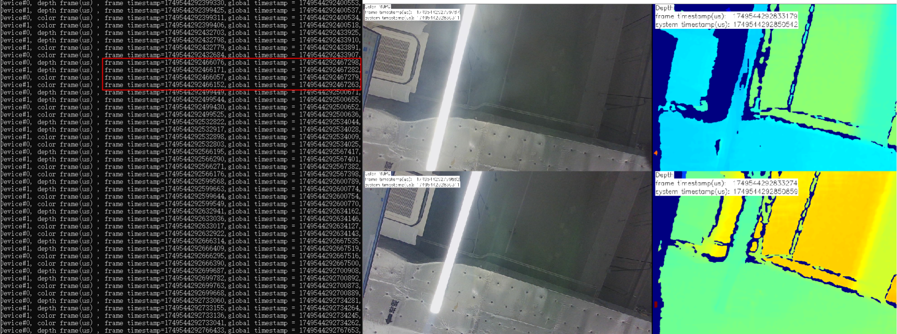

# 日志管理

每个日志管理接口都有一个日志级别参数，日志级别由最后调用的接口决定。
要设置全局日志级别，可使用 setLoggerSeverity 函数，它同时控制控制台输出、文件输出和日志回调函数的日志级别。
以下三种日志输出方式相互独立，设置其中一种不会影响其他方式。

- 1、将日志输出到控制台（setLoggerToConsole 函数）
- 2、将日志输出到文件（setLoggerToFile 函数）
- 3、通过回调函数输出日志（setLoggerToCallback 函数）

## 设置日志级别

```
typedef enum {
    OB_LOG_SEVERITY_DEBUG, /**< 调试 */
    OB_LOG_SEVERITY_INFO,  /**< 信息 */
    OB_LOG_SEVERITY_WARN,  /**< 警告 */
    OB_LOG_SEVERITY_ERROR, /**< 错误 */
    OB_LOG_SEVERITY_FATAL, /**< 致命错误 */
    OB_LOG_SEVERITY_OFF    /**< 关闭（不输出日志） */
} OBLogSeverity
```
```
ob::Context  context;
// 设置日志输出的日志级别。
context.setLoggerSeverity(OB_LOG_SEVERITY_DEBUG);
```


这是全局接口。设置该接口会影响控制台输出、文件输出和日志回调函数的日志级别。

如果先调用 setLoggerSeverity 函数设置日志级别，之后再调用其他接口设置日志级别，则以最后设置的日志级别为准。


## 将日志输出到控制台
```
ob::Context  context;
// 将日志输出到终端控制台。
context.setLoggerToConsole(OB_LOG_SEVERITY_DEBUG);
```
注意：仅影响输出到控制台的日志级别。


## 将日志输出到文件
```
ob::Context  context;
// 将日志输出到文件。
context.setLoggerToFile(OB_LOG_SEVERITY_DEBUG, "Log/Custom/");
```

注意：仅影响输出文件的日志级别。

## 设置日志回调输出
```
    context.setLoggerToCallback(OB_LOG_SEVERITY_DEBUG,
                                     [](OBLogSeverity severity, const char *logMsg) { std::cout << "[CallbackMessage][Level:" << severity << "]" << logMsg; });
```

注意：仅影响输出到回调函数的日志级别。

## 修改配置文件中的日志级别

下面介绍 Orbbec SDK 配置文件（OrbbecSDKConfig.xml）。
```
    <Log>
        <!-- 日志输出级别，int 类型，可选值：0-DEBUG、1-INFO、2-WARN、3-ERROR、4-FATAL、
        5-OFF -->
        <!-- 文件日志输出级别 -->
        <FileLogLevel>5</FileLogLevel>
        <!-- 控制台日志输出级别 -->
        <ConsoleLogLevel>3</ConsoleLogLevel>
        <!-- 默认日志输出文件路径，string 类型。如果未配置该项，
        将使用默认路径：Win/Linux："./Log"；Android："/sdcard/orbbec/Log" -->
        <!-- <OutputDir>./log</OutputDir> -->
        <!-- 默认日志输出文件大小，int 类型，单位：MB -->
        <MaxFileSize>100</MaxFileSize>
        <!-- 默认日志文件数量（循环覆盖），int 类型 -->
        <MaxFileNum>3</MaxFileNum>
        <!-- 日志异步输出，改为异步输出可以减少打印日志的阻塞时间，
        但程序异常退出时可能丢失部分日志；true-开启，
        false-关闭（默认） -->
        <Async>false</Async>
    </Log>
```

