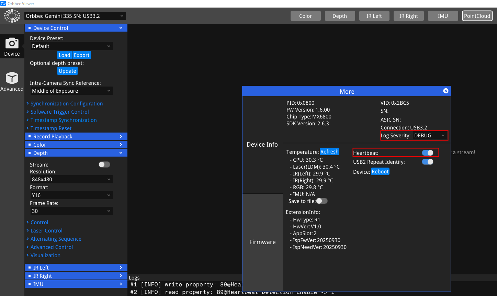
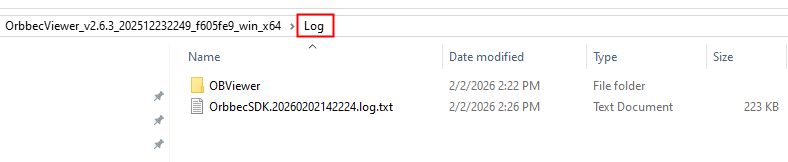
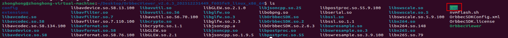
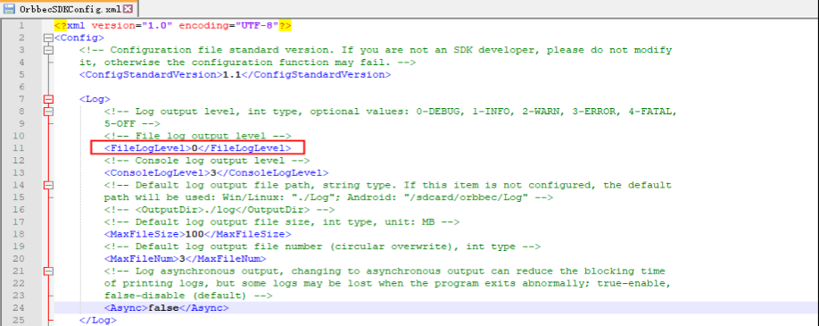
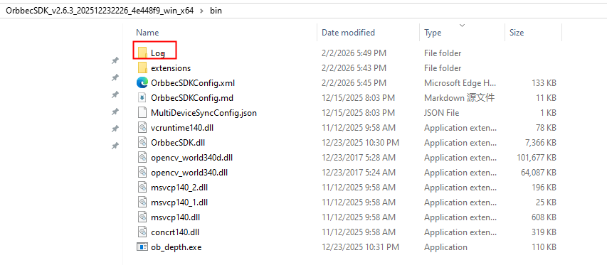
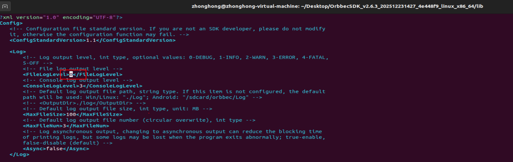
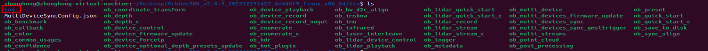

# 如何保存 Orbbec SDK v2 的日志

本指南介绍了如何在 Windows 和 Linux 系统上从 OrbbecViewer 和 Orbbec SDK v2 应用程序中保存日志。

## 如何使用 OrbbecViewer 保存日志
首先，将日志级别设置为 Debug。要启用设备固件日志，请勾选 Heartbeat 选项。




日志保存在与 OrbbecViewer 位于同一目录下的 Log 文件夹中。
- 注意：如果通过安装程序安装 SDK，日志将保存在安装路径中与 OrbbecViewer 同级的 Log 目录下。

### Windows

在 Windows 操作系统中，日志路径如下图所示：




### Linux (x64/ARM64)
在 Linux (x64/ARM64) 操作系统中，日志路径如下图所示：




## 如何在 Orbbec SDK v2 应用程序中保存日志

### Windows
- 将 OrbbecSDKConfig.xml 复制到与 OrbbecSDK.dll 相同的目录下。
- 将 File Log 级别设置为 0（Debug）。



- 要启用固件日志记录，请在对应的设备配置段中将 DefaultHeartBeat 设置为 1。以下是 Gemini 335Le 的示例：
```
    <Gemini335Le>
        <!-- 是否默认启用心跳 -->
            <DefaultHeartBeat>1</DefaultHeartBeat>
    </Gemini335Le>
```
- 日志保存在与应用程序同级的 Log 文件夹中。例如：




### Linux (x64/ARM64)
- 将 OrbbecSDKConfig.xml 复制到与 libOrbbecSDK.so 相同的目录下。
- 将 File Log 级别设置为 0（Debug）。


- 要启用固件日志记录，请在对应的设备配置段中将 DefaultHeartBeat 设置为 1。以下是 Gemini 335Le 的示例：
```
    <Gemini335Le>
        <!-- 是否默认启用心跳 -->
            <DefaultHeartBeat>1</DefaultHeartBeat>
    </Gemini335Le>
```
- 日志保存在与应用程序同级的 Log 文件夹中。例如：



# 如何提高 usbfs 内存限制

Linux 计算机（Ubuntu）的 USB 缓冲区配置：默认情况下，Linux 主机仅为 USB 控制器操作分配 16 MB 的内核内存。处理高分辨率图像或多个数据流和设备，当前分配量可能不足。为了支持多个设备，USB 控制器需要更多的内存。请按照以下步骤增加内存分配：
```
echo 128 | sudo tee /sys/module/usbcore/parameters/usbfs_memory_mb
```

若要使该设置永久生效：
- 打开 `/etc/default/grub` 文件，查找并替换
```
GRUB_CMDLINE_LINUX_DEFAULT="quiet splash"
```

使用以下内容
```
GRUB_CMDLINE_LINUX_DEFAULT="quiet splash usbcore.usbfs_memory_mb=128"
```

- 更新 grub
```
sudo update-grub
```

- 重启并检查

```
cat /sys/module/usbcore/parameters/usbfs_memory_mb
```


